<div align="center">

<picture>
  <source media="(prefers-color-scheme: dark)" srcset="web/public/favicon.svg">
  
</picture>

# NASSA - NAS Storage Analyzer

**See where your storage goes.**

Scans your NFS and SMB shares read-only and shows what takes the space, per share, folder and file type, even with millions of files and tens of terabytes. You clean up yourself, with a script that you read and you run.

🇬🇧 **English** · 🇳🇱 [Nederlands](README.md)

[](#getting-started)
[](#installation-self-hosted)
[](#features)

[](https://github.com/helmerzNL/NAS-Storage-Analyzer/releases/latest)
[](https://github.com/helmerzNL/NAS-Storage-Analyzer/commits/beta)
[](https://github.com/helmerzNL/NAS-Storage-Analyzer/graphs/commit-activity)
[](https://github.com/helmerzNL/NAS-Storage-Analyzer/forks)
[](https://github.com/helmerzNL/NAS-Storage-Analyzer/stargazers)
[](https://github.com/helmerzNL/NAS-Storage-Analyzer/issues)
[](https://github.com/helmerzNL/NAS-Storage-Analyzer/graphs/contributors)

[](https://buymeacoffee.com/flux76)
[](https://ko-fi.com/flux76)

[Documentation](docs/) · [Changelog](docs/releases/) · [Report a bug](https://github.com/helmerzNL/NAS-Storage-Analyzer/issues/new/choose)

<picture>
  <source media="(prefers-color-scheme: dark)" srcset="docs/screenshots/en/dark.png">
  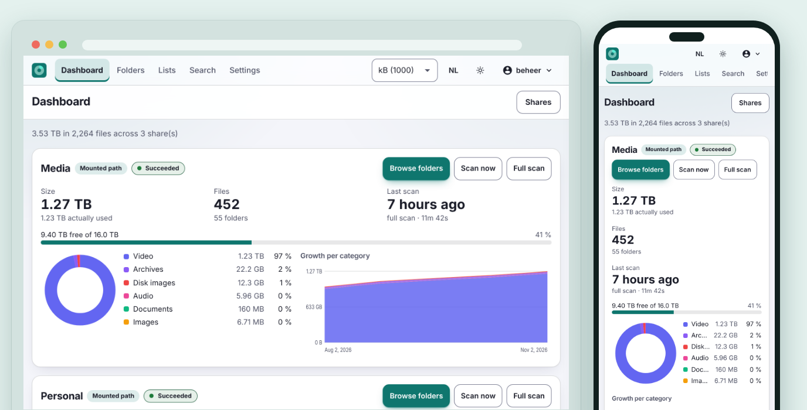
</picture>

</div>

---

## Contents

- [Why NASSA?](#why-nassa)
- [Features](#features)
- [Screenshots](#screenshots)
- [Getting started](#getting-started)
- [Usage](#usage)
- [Configuration](#configuration)
- [Running it](#running-it)
- [Data and backups](#data-and-backups)
- [Architecture](#architecture)
- [Stable and beta](#stable-and-beta)
- [Contributing](#contributing)
- [Privacy and security](#privacy-and-security)
- [Support NASSA](#support-nassa)
- [License](#license)

## Why NASSA?

A NAS fills up slowly, and on a share with millions of files *where did the space go?* is not a question you answer in a minute: walking everything again takes a long time, and what you saw the last time is gone. NASSA runs in Docker, on your NAS or next to it, scans your shares read-only and keeps a snapshot of every scan. You see what is there now and what is growing, and the next scan reuses the folders that did not change. Cleaning up stays your decision: NASSA deletes nothing itself, it writes a script that you read and you run.

## Features

- **Read-only**: NASSA reads only metadata from your NAS (`stat` and directory listings, never the contents of a file) and writes nothing back. The recommended setup mounts your shares read-only in the container.
- **Built for many files**: parallel workers, large batches into PostgreSQL and precomputed totals per folder, per category and per extension. At 10 million files the views stay under half a second, except two broad age filters over a *whole* share (2.0 to 2.6 s); the measurements are in [`docs/bench-phase2.md`](docs/bench-phase2.md).
- **Smart scanning, on a schedule**: unchanged folders are reused, so the next scan is much faster. Exclude patterns, symlinks are not followed, a hardlink counts once, the size actually allocated (`st_blocks`) sits next to the logical size, the IO can be limited, and you see live progress and can cancel. A cron schedule per share, with a job status that survives a restart. A scan that finds nothing where the previous one saw more than 100 files (a share that is no longer mounted) is refused and keeps your old data.
- **Dashboard, file types and history**: per share the size, the number of files, how full the disk is, a donut per file type and the growth per category over time. Every scan is a snapshot, with a retention period you set. The eight categories (Video, Audio, Images, Documents, Archives, Code, Disk images, Other) follow an extension table you can edit; a change shows up in every number at once, without scanning again.
- **Folders, map and lists**: browse with percentages and sorting, a treemap that shows the big blocks at a glance, and filters you combine: category, extension, size, modified, last used and name. Lists of the largest and the longest-unused files and folders, per share, plus search by name. CSV export of every overview.
- **Delete scripts**: tick files and folders and get one script (`.ps1`, `.cmd`, `.sh` or a simple `.txt`) that deletes exactly those. **NASSA never deletes anything itself**: it writes the text, you run it. See [Deleting](#deleting).
- **Secure sign-in, for several users**: local accounts with Argon2id, a **mandatory second factor** (authenticator app or passkey, passwordless with a passkey alone too), recovery codes, lockout, CSRF protection, the roles Admin and Viewer and an audit log. No default passwords. An administrator invites others with a one-time link; nobody chooses anyone else's password.
- **Settings per person**: Dutch or English, binary or decimal units, light, dark or following your system, and an accent colour of your own.
- **For operators**: an OpenAPI REST API, Prometheus `/metrics`, JSON logs, health checks, a backup of what you entered yourself and a factory reset.
- **Your data, your server**: everything runs in your own containers. The update check only asks GitHub whether a newer release exists and sends nothing about your installation; switch it off with `NASSA_UPDATE_CHECK=false`.

How to use each feature is under [Usage](#usage); what it cannot do (yet) is under [Known limitations](#known-limitations).

## Screenshots

Every image shows the same page on a computer and on a phone.

| Dashboard | Folders |
|:---:|:---:|
|  | 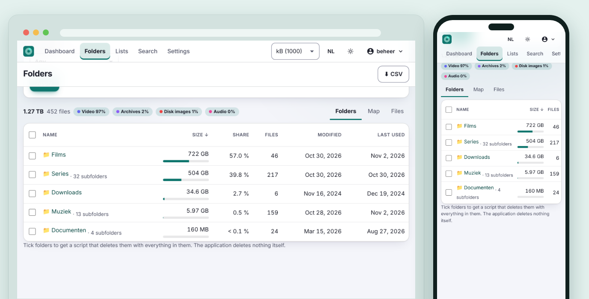 |

| Map | Lists |
|:---:|:---:|
| 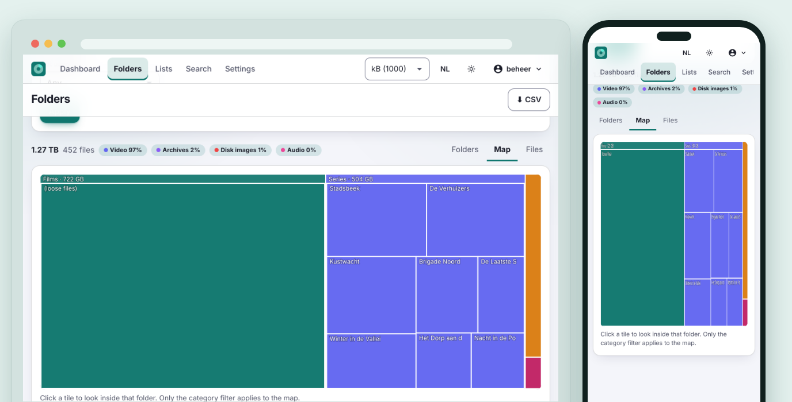 | 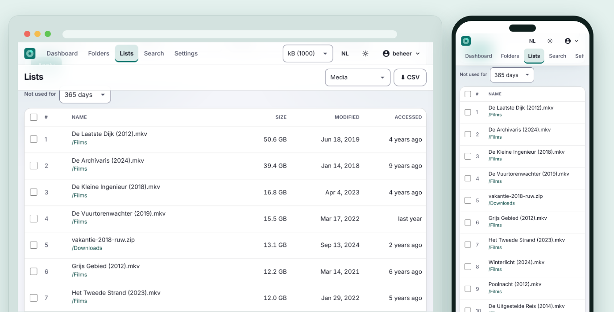 |

| Selecting | Delete script |
|:---:|:---:|
| 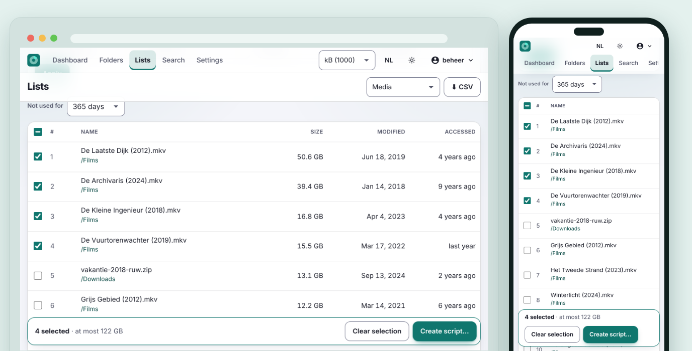 | 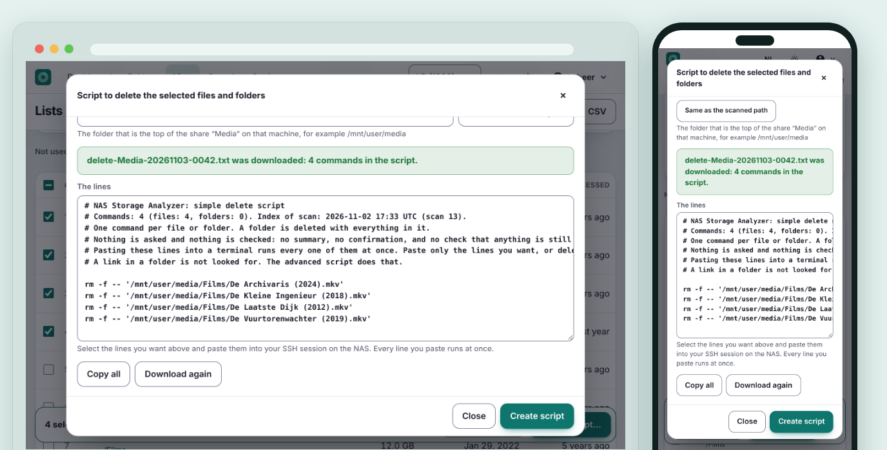 |

| Settings, Delete | Audit log |
|:---:|:---:|
| 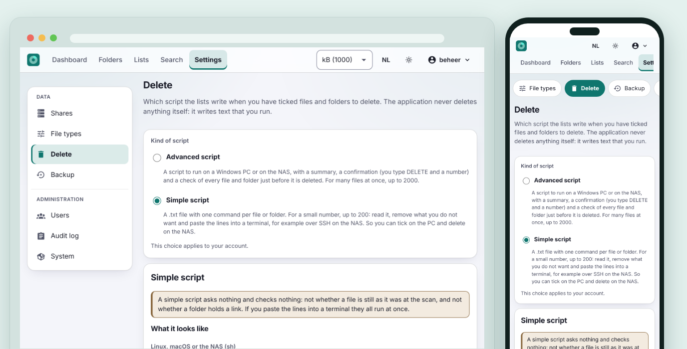 | 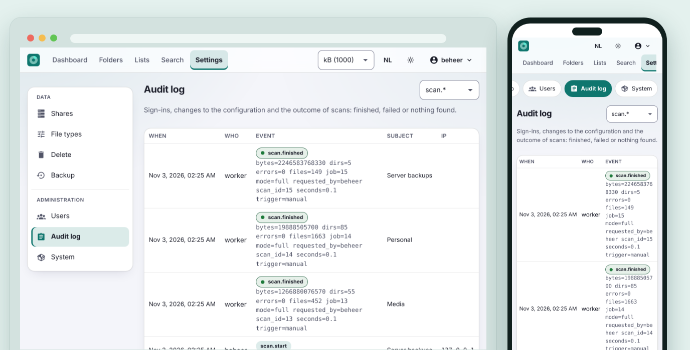 |

| Backup | Dark theme |
|:---:|:---:|
| 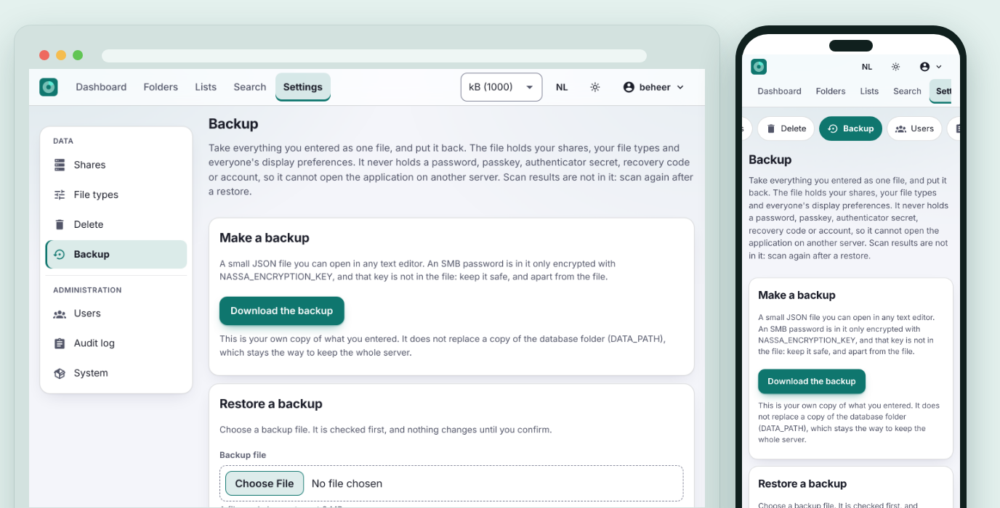 | 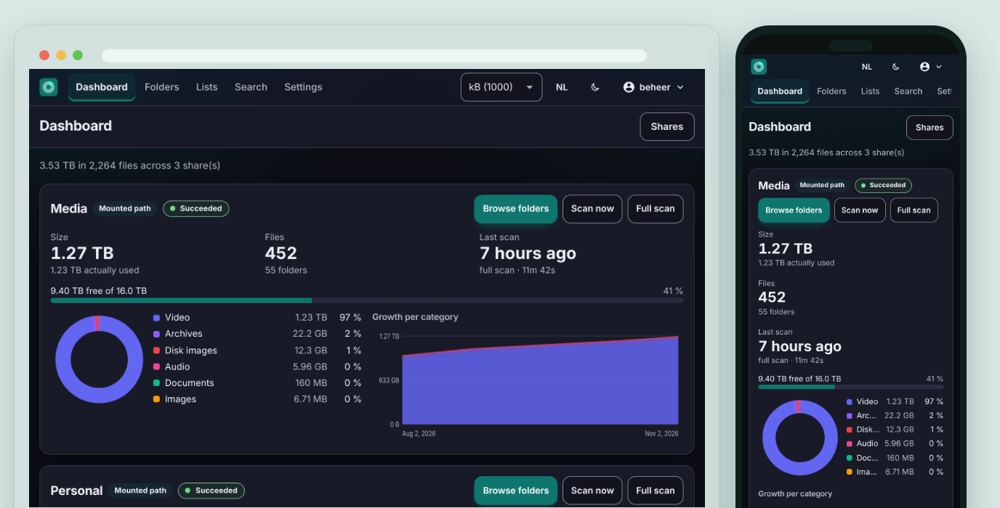 |

<sub>The screenshots show sample data, made with special (sparse) files that look much bigger than they are. They come from [`web/e2e/screenshots.cjs`](web/e2e/screenshots.cjs), so they are always the real application.</sub>

## Getting started

- 🐳 **Self-hosted:** install the stack with Docker, see [Installation](#installation-self-hosted).
- 🌐 **Web:** then open the address of your own installation, on a computer or a phone; the interface adapts to the screen.

### Installation (self-hosted)

You need Docker with Compose v2, on the NAS itself or on a machine that can see your shares.

```bash
git clone https://github.com/helmerzNL/NAS-Storage-Analyzer.git
cd NAS-Storage-Analyzer
./scripts/init-env.sh --data-path /srv/nas-storage-analyzer --shares-dir /srv/nas
docker compose up -d
```

`init-env.sh` creates `.env` with random secrets (database password, encryption key, setup token) and the two folders. It never overwrites anything and refuses a relative path. Without options it picks `/mnt/user/appdata/nas-storage-analyzer` and `/mnt/user` on Unraid and `/srv/nas-storage-analyzer` and `/srv/shares` elsewhere; check what it chose.

The stack pulls `ghcr.io/helmerznl/nas-storage-analyzer` (for `linux/amd64` and `linux/arm64`); nothing is built on the server. To build it from this folder anyway: `docker compose -f docker-compose.yml -f docker-compose.build.yml up -d --build`.

**Where the data lives.** Everything that must not be lost (the database, in `DATA_PATH/postgres`) is in one **absolute** host folder: `DATA_PATH` in `.env`. They are plain folders, never Docker volumes, so `docker compose down -v`, a prune or a rebuild cannot touch them. A relative path is refused: it is resolved by whatever tool starts the stack, and that is not always the host (Dockhand on Unraid resolved such a path into the RAM disk for another app).

Then open <http://127.0.0.1:8080>. By default the app listens on that machine only; if you run it on a NAS and want to reach it from another device, set `NASSA_HTTP_BIND=0.0.0.0` (and preferably put a [reverse proxy](#reverse-proxy-and-https) with https in front).

> **Already running NASSA from before v0.2.0?** All environment variables are now called `NASSA_*` instead of `NASA_*`, and an old `.env` is refused. One command fixes it, see [Updating](#updating).

### First start

A new installation opens a setup wizard; an existing installation does not see it.

1. **Setup token.** Enter the `NASSA_SETUP_TOKEN` from `.env`. If there is none, a random token is in the log: `docker compose logs app | grep setup_token`.
2. **Administrator.** Choose a name and a password. There are no default passwords.
3. **Second factor.** Set up an authenticator app (you get recovery codes, shown once) or a passkey. This is mandatory, for every account.
4. **First share.** Choose **Shares → Add share**, click **Browse…** and pick the folder (or type the path). The share is tested at once: below the share it says whether the worker can reach it. Then click **Scan now** on the dashboard.

Passkeys are bound to a host name and only work over https or on `localhost`. In production set `NASSA_RP_ID` and `NASSA_RP_ORIGINS`, see [Reverse proxy and https](#reverse-proxy-and-https).

### Making shares available

NASSA reads a plain folder. How that folder gets to the container is set by `NASSA_SHARES_DIR` (required, an absolute path on the host); it appears **read-only** as `/mnt/shares` in `app` and `worker`.

**Route b (recommended): mount on the host.** Mount the NFS or SMB share read-only on the Docker host and pass on the folder. The containers then need no special privileges and cannot change anything on the NAS.

```bash
# /etc/fstab on the host
nas.lan:/volume1/media  /srv/nas/media  nfs  ro,vers=4.1,_netdev,x-systemd.automount,noatime  0 0
```

```bash
# .env
NASSA_SHARES_DIR=/srv/nas
```

Add the share in the interface as type *Mounted path*: click **Browse…** and choose `/mnt/shares/media`.

**Route c: the stack runs on the NAS itself** (for example Unraid). There is nothing to mount: the shares are plain folders. Pass on that folder and set `NASSA_SHARES_MOUNT` to the same path, and the paths in the interface are the ones you know from the NAS.

```bash
# .env
NASSA_SHARES_DIR=/mnt/user
NASSA_SHARES_MOUNT=/mnt/user
```

Do the folder picker or the scan report *permission denied* for a folder with `drwxrwx---` for `nobody:users`? Set `NASSA_SHARES_GID=100`.

**Route a: the worker mounts itself**, with `docker compose -f docker-compose.yml -f docker-compose.mounts.yml up -d`. That gives only the worker root, `CAP_SYS_ADMIN`, `CAP_DAC_READ_SEARCH` and `CAP_DAC_OVERRIDE` (SMB needs all three: without one of them, `mount.cifs` stops with *Unable to apply new capability set* (older versions: *Unable to set current process capabilities*)); in the interface you enter the server, export or share, version and optionally SMB credentials (stored encrypted). This route was tested up to the privileges and with a simulated mount runner, but not against a real NFS or SMB server. Test a new share with *Scan now*.

**Test connection.** Every share has a **Test connection** button under **Settings → Shares**. The worker mounts the share (or looks up the path), reads only the top folder and says within seconds whether that works, how many items are there, or what goes wrong, in the words of `mount` itself. A new share is tested right after it is added. A test is not a scan: nothing is indexed and no file is opened.

Only what you add as a share is scanned. A share that is no longer mounted leaves an empty folder behind; a scan that then finds nothing where the previous one saw more than 100 files is refused and keeps the old data. Details, SMB examples, AppArmor, single Unraid disks and Exclusive shares: [`docs/deploy.md`](docs/deploy.md#2-shares-beschikbaar-maken) (in Dutch, with an English summary at the end).

### Unraid and Home Assistant

Where a platform runs one container per app (the Unraid Community Applications store, a Home Assistant add-on), there is an all-in-one image: `ghcr.io/helmerznl/nas-storage-analyzer-aio`, with the same tags. It runs PostgreSQL 16, the web interface and the worker in one container and keeps everything in `/data`. `NASSA_ENCRYPTION_KEY` is required there too: `docker run --rm ghcr.io/helmerznl/nas-storage-analyzer-aio genkey` makes one. If the worker should mount SMB or NFS shares itself there, give the container `--cap-add SYS_ADMIN --cap-add DAC_READ_SEARCH` on top of Docker's default capabilities (`SYS_ADMIN` is enough for NFS; where AppArmor blocks the mount, add `--security-opt apparmor=unconfined`). Compose stays the recommended route; details in [`docs/deploy.md`](docs/deploy.md#8b-all-in-one-image-unraid-store-en-home-assistant) and [ADR 0013](docs/adr/0013-all-in-one-image.md).

## Usage

### Scanning

**Scan now** on the dashboard scans incrementally: folders that did not change are reused. **Full scan** reads everything again (by default that also happens on every seventh scan). A scan runs in the `worker`, you see the progress live and can cancel it; a cancelled or failed scan leaves the earlier data alone. Per share you set a cron schedule and exclude patterns, the number of parallel workers and a limit on file operations per second and per day (with a day and a night window of its own), how many scans and how many days of history are kept, and whether "last used" is the access time (`atime`), the modification date or the maximum of the two.

The dashboard shows one card per share: how much space the files take (and how much is really allocated), how much of the disk is still free, which file types are largest and how that grows per category. An **error during a scan** is shown there: the red message for a failed scan, or the badge *N errors* for a scan that could not read everything. As an administrator you click it and land directly on the audit log entry, with the cause, a tip and the list of folders that could not be read.

### Browsing and searching

Under **Folders** you browse a share with the tabs *Folders*, *Map* (treemap) and *Files*: the folders with their size, share of the total, number of files and dates. Open a folder, sort on a column, or click a tile of the map to look inside that folder; the filters (category, extension, size, age, name) combine. **Lists** shows the largest and the coldest files and folders, for example everything that has not been opened for a year, and **Search** searches by name. Every overview can be exported as CSV.

The units (binary or decimal), the language and the theme sit next to each other at the top; the theme button cycles between dark, light and whatever your device does. Together with the accent colour they are also under your name → *Appearance and language*; they apply to your account.

The **file types** (*Settings → File types*) can be edited: moving an extension to another category shows up in every number at once, without a new scan.

### Deleting

Administrators tick files and folders in the lists and under *Folders*. At the bottom you see how many you ticked and how much space that frees at most; **Create script…** gives one script. **The application deletes nothing itself.**

- **Advanced** (`.ps1`, `.cmd` or `.sh`): shows a summary, asks you to type `DELETE <count>`, checks the size and time of every file right before deleting and keeps any file that changed since the scan. For many files at once: at most 2,000 per script. What the script cannot address safely (odd characters, names Windows cannot open, names that differ only in case) it leaves out and lists.
- **Simple** (`.txt`): one command per file or folder (`rm`, `Remove-Item`, or `del` and `rd`), for a small number (up to 200) to read, trim and paste into a terminal, for example over SSH on the NAS. It asks and checks **nothing**.
- **Folders** go **with everything in them**. The number you type also counts what the scan found in those folders; the script keeps a folder, and says so, when it now holds more than at the scan or a link. The share itself is never deleted, and `cmd` takes no folders.

Under *Settings → Delete* you choose which of the two the lists make. Where your machine sees the share (`\\nas\media`, `Z:\`, `/mnt/user/media`) is set per share. See [ADR 0006](docs/adr/0006-delete-scripts.md), [ADR 0010](docs/adr/0010-delete-scripts-take-folders.md) and [ADR 0011](docs/adr/0011-simple-delete-scripts.md).

### Users and invitations

Nobody chooses anyone else's password. An administrator makes an **invitation link** under **Settings → Users** (you choose the role) and passes it on; the guest chooses their own password or a passkey. The link is shown once, works once, expires after 7 days and is stored nowhere (only its hash). *New login link* brings back someone who can no longer sign in. `NASSA_PUBLIC_URL` is the address the links point at. Details and limits: [`docs/deploy.md` §4b](docs/deploy.md#4b-gebruikers-uitnodigen).

## Configuration

Set in `.env`; [`.env.example`](.env.example) documents every value. The most important:

| Variable | Required | Default | Description |
|---|:---:|---|---|
| `DATA_PATH` | ✅ | - | Absolute host folder with everything that must be kept; the database is in `DATA_PATH/postgres`. Never relative, never a Docker volume. |
| `NASSA_TAG` | ❌ | `latest` | Which image: `latest` (stable), `beta` or a version number. It is also set in the container; a beta build shows a **beta** label. |
| `NASSA_DB_PASSWORD`, `NASSA_ENCRYPTION_KEY` | ✅ | - | Made by `scripts/init-env.sh`. The key encrypts SMB passwords; keep it with your backup. |
| `NASSA_SETUP_TOKEN` | ❌ | random, in the log of `app` | Needed to create the first administrator. |
| `NASSA_SHARES_DIR` | ✅ | - | Absolute host folder with the mounted shares (read-only in the containers). |
| `NASSA_SHARES_MOUNT` | ❌ | `/mnt/shares` | Where that folder appears in the containers, and so the path you type in the interface. Set it equal to `NASSA_SHARES_DIR` and the paths are the same everywhere. |
| `NASSA_SHARES_GID` | ❌ | `10001` | Group the containers join to read shares that only the owner and one group may read (Unraid: `100`). |
| `NASSA_HTTP_BIND`, `NASSA_HTTP_PORT` | ❌ | `127.0.0.1`, `8080` | Where `app` listens; by default on the machine itself only. |
| `NASSA_TRUSTED_PROXIES`, `NASSA_REQUIRE_HTTPS` | ❌ | empty, `false` | Behind a reverse proxy: which proxies may set `X-Forwarded-*`, and enforcing https. |
| `NASSA_RP_ID`, `NASSA_RP_ORIGINS`, `NASSA_PUBLIC_URL` | ❌ | empty | Passkeys are bound to a host name, and invitation links need an address; set them in production. |
| `NASSA_METRICS_TOKEN` | ❌ | empty | Bearer token for `/metrics`; without a token only from loopback. |
| `NASSA_UPDATE_CHECK` | ❌ | `true` | `false` switches the update check off. |
| `NASSA_TZ` | ❌ | `Europe/Amsterdam` | Time zone for cron schedules and the day/night window. |
| `PG_*` | ❌ | see `.env.example` | Tune PostgreSQL to the memory available. |

**Secrets** live in `.env` or, better, in Docker secrets (`./scripts/init-env.sh --secrets`). Most `NASSA_*` settings have a `_FILE` variant. `.env` never goes into git; only `.env.example` (without secrets) is in the repository.

The command is still called `nasa` (`nasa serve`, `nasa scan`, …), and so are the default name and user of the database; only the environment variables are called `NASSA_*` (see [ADR 0012](docs/adr/0012-nassa-environment-variables.md)).

### Reverse proxy and https

Put NASSA behind https as soon as it is reachable beyond your own machine: cookies then become `Secure`, and passkeys only work over https or on `localhost`. An example with Caddy:

```caddyfile
nas.example.com {
    reverse_proxy 127.0.0.1:8080 {
        flush_interval -1      # live scan progress (server-sent events)
    }
}
```

```bash
# .env
NASSA_TRUSTED_PROXIES=127.0.0.1
NASSA_REQUIRE_HTTPS=true
NASSA_RP_ID=nas.example.com
NASSA_RP_ORIGINS=https://nas.example.com
```

Examples for nginx and Traefik and an explanation of `X-Forwarded-*`: [`docs/deploy.md`](docs/deploy.md#3-reverse-proxy-en-https).

## Running it

| Task | Command |
|---|---|
| Start | `docker compose up -d` |
| Stop | `docker compose down` (the data in `DATA_PATH` stays) |
| Update | `docker compose pull && docker compose up -d` |
| Roll back | set `NASSA_TAG` to the previous version, then `docker compose pull && docker compose up -d` (see [Updating](#updating)) |
| Logs | `docker compose logs -f app worker` |
| Status | `docker compose ps` shows `(healthy)` for `app`, `worker` and `db` |

- **Health check:** `GET /healthz` answers `200` with `ok` as soon as `app` runs; `GET /readyz` answers `200` with `ready` when the database answers too (the Compose health check uses it). The `worker` has its own `/healthz` on port 8081 inside the container. Every endpoint: [`docs/operations.md`](docs/operations.md#2-health-check-endpoints).
- **Largest upload:** 8 MiB, for restoring a backup; every other request is at most 64 KiB. Whatever runs in front of the app (a reverse proxy, a CDN) must allow at least that much, and for the CSV export and the live scan progress also switch buffering off and allow long timeouts: [`docs/operations.md`](docs/operations.md#6-limits-that-live-outside-the-repository).
- **Update check:** the administrator gets a notice (a banner and the *About* screen) when a newer release exists; the app never updates itself.

### Updating

```bash
docker compose pull
docker compose up -d
```

A stack manager (Dockhand, Komodo, Portainer) usually has its own *pull* or *update* action for that. **Redeploying does not fetch a moving tag (`latest`, `beta`) by itself**: pull first. Check what runs with the **About** screen or `curl -s http://<host>:8080/api/v1/version`. Migrations run at start-up; make a backup first. Going back to an earlier version: set `NASSA_TAG` to that version number, and restore the backup from before the update if the [release notes](docs/releases/) say the schema is not compatible.

**Once, from before v0.2.0: the variables are called `NASSA_` instead of `NASA_`.** An `.env` with the old names is refused (Compose and the app both name the new one), instead of silently using the defaults. Change the file once, and in a stack manager the variables there too (Dockhand keeps them in `.env.dockhand`):

```bash
sed -i 's/^NASA_/NASSA_/' .env
```

`DATA_PATH` and `PG_*` are still called the same; the command `nasa`, the database and the metrics did not change, so existing data and dashboards keep working. Is your database still in the `db-data` volume (a version from before `DATA_PATH`)? Then move it once, before you roll out: [`docs/deploy.md` §8](docs/deploy.md#8-bijwerken).

### Troubleshooting

| Symptom | Cause and fix |
|---|---|
| `docker compose up` says `NASSA_SHARES_DIR` is missing, or names a variable with `NASA_` | An `.env` from before v0.2.0: `sed -i 's/^NASA_/NASSA_/' .env`. |
| **Browse…** shows "No folders found", or the scan finds nothing | The shares folder is empty in the container: nothing is mounted, or `NASSA_SHARES_DIR` points somewhere other than you think (or is relative). The audit log then shows `scan.empty`. |
| You do not know whether the worker can reach a share | **Settings → Shares → Test connection**: the outcome appears below it within seconds, with the message of `mount` when it fails. "No worker picked the test up" means the worker is not running. |
| Scan fails with "permission denied" | The container runs as uid 10001 and does not own the folder. Set `NASSA_SHARES_GID` to the group that owns the share (Unraid: `100`). |
| The screen asks for a setup token you do not have | `docker compose logs app \| grep setup_token`, or `NASSA_SETUP_TOKEN` in `.env`. |
| Passkeys do not work ("Passkeys need a secure address") | Open the app through a host name with https (or `http://localhost`) and set `NASSA_RP_ID`. |
| A scan error on the dashboard | Click it (administrator): the audit log shows the cause and the folders that could not be read. |
| `/metrics` gives 401 or 403 | Set `NASSA_METRICS_TOKEN` and send it; without a token only loopback is answered. |
| `worker` stays `unhealthy` | `docker compose logs worker`: usually the database cannot be reached. |

All symptoms: [`docs/deploy.md`](docs/deploy.md#10-problemen-oplossen).

## Data and backups

Everything lives under `DATA_PATH`:

| Folder | What is in it |
|---|---|
| `postgres` | The PostgreSQL database: the file index, the precomputed totals, the history, the shares, the accounts and the settings. |

The encryption key `NASSA_ENCRYPTION_KEY` lives outside the database, in `.env` or a Docker secret. There are two kinds of backup:

- **In the app** (*Settings → Backup*, administrators): what you entered yourself (shares, file types, everyone's display preferences) as one small JSON file, restorable after a check that changes nothing until you confirm. It never holds a password, passkey, authenticator secret, recovery code, account or role; an SMB password only encrypted with `NASSA_ENCRYPTION_KEY`, which is not in the file. Scan results are not in it (scan again after a restore). It does not replace a copy of the database.
- **The whole database**, with `pg_dump`:

  ```bash
  docker compose exec -T db sh -c 'pg_dump -U "$POSTGRES_USER" -d "$POSTGRES_DB" -Fc' > nassa-$(date +%F).dump
  ```

  Restore: `docker compose up -d db`, then `docker compose exec -T db sh -c 'pg_restore -U "$POSTGRES_USER" -d "$POSTGRES_DB" --clean --if-exists --no-owner' < nassa-….dump`, then `docker compose up -d`. Keep `NASSA_ENCRYPTION_KEY` with the dump: without the key the stored SMB passwords cannot be decrypted. A copy of `DATA_PATH/postgres` with the database stopped works too. The full procedure: [`docs/deploy.md`](docs/deploy.md#5-back-up-en-herstel).

*Settings → System → Factory reset* puts the installation back to new (every table emptied, the wizard starts again); you type `RESET` and prove who you are again. Your files on the NAS stay untouched.

## Architecture

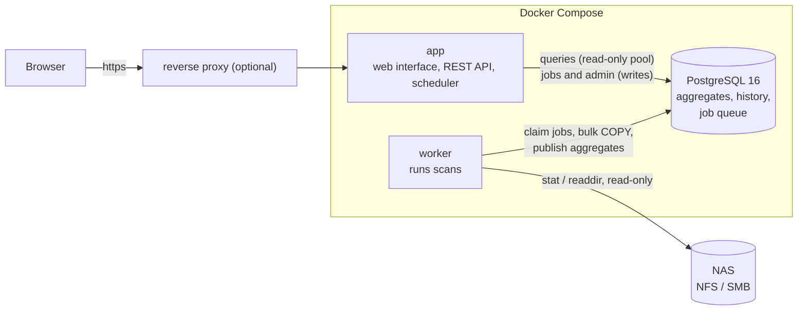

| Component | Purpose | Data |
|---|---|---|
| `app` | Serves the interface (baked into the binary), the REST API and the scheduler. It does not scan and runs without privileges. Only for the folder picker does it read (read-only, administrators only) the names of folders under the shares folder; files are not shown or opened. | None of its own |
| `worker` | Takes scan jobs from the queue in the database (`FOR UPDATE SKIP LOCKED`), scans, and publishes the result in one transaction. Only the worker scans the NAS, and in the recommended setup only through a read-only bind mount. | None of its own; reads the share |
| `db` (PostgreSQL 16) | The file index (a partition per share, folders as `ltree`) and the precomputed totals per folder, per folder and category, and per extension, plus the history, the accounts and the job queue. That is why most views read a few thousand rows instead of all the files. | `DATA_PATH/postgres` |
| the NAS share | What is being measured | Never written to |

The full design and the trade-offs: [`docs/ontwerp.md`](docs/ontwerp.md) (in Dutch). The REST API is described in [`api/openapi.yaml`](api/openapi.yaml) and served by `app` at `/openapi.yaml`; contract tests validate every response against the specification. How the app answers the app-engineering topics: [`docs/app-engineering-conformance.md`](docs/app-engineering-conformance.md).

### Known limitations

- **atime is often unreliable.** Many NAS systems and network mounts do not update the access time. The scanner measures per scan how reliable atime looks and the interface warns at "not used since"; per share you choose atime, modification date or the maximum of the two. "Last used" remains an estimate.
- **Incremental scans** reuse a folder when `mtime` and the number of entries are equal. A file that grows in place and a new hardlink in an unchanged folder are only seen at the next full scan (by default every seventh; also with one click).
- Two broad age filters over a *whole* share of 10 million files take 2.0 to 2.6 s; every other view stays under 500 ms.
- One directory is read in one go; a folder with millions of entries costs noticeable memory in the worker.
- **Delete scripts** are only as good as the index. They check size and time before deleting, but a file that was replaced since the scan by another of the same size and time cannot be told apart. For a folder the script checks counts, not every file. The simple script checks nothing.
- No OIDC; the auth layer is set up so that an extra sign-in method can create a session, but the integration is not built.

All limitations with explanation: [`docs/deploy.md`](docs/deploy.md#9-bekende-beperkingen).

## Stable and beta

| | Stable | Beta |
|---|---|---|
| Branch | `main` | `beta` |
| Image | `ghcr.io/helmerznl/nas-storage-analyzer:latest` (and `X.Y.Z`) | `ghcr.io/helmerznl/nas-storage-analyzer:beta` (and `beta-<sha>`) |
| GitHub release | `vX.Y.Z` | `vX.Y.Z-beta.N`, pre-release |

Every change lands in the **beta** first; only a deliberate promotion from `beta` to `main` makes a stable version of it. Which image runs is chosen with `NASSA_TAG`:

| `NASSA_TAG` | What you get |
|---|---|
| `latest` | The stable line. Published when `beta` is promoted to `main`. |
| `beta` | The build every change lands in first; the interface shows a **beta** label. Use a separate `DATA_PATH`. |
| `0.3.1` (a version number) | Stays put until you change it. |

Every stable version is listed under [Releases](https://github.com/helmerzNL/NAS-Storage-Analyzer/releases). What changed per version is in the [release notes](docs/releases/), in Dutch and English.

## Contributing

Contributions are welcome. Pull requests go to the `beta` branch, never to `main`; `main` only gets a promotion pull request from `beta`. The working conventions for people and AI assistants alike are in [`AGENTS.md`](AGENTS.md). Pull requests do not change `VERSION`, the pipeline does. After cloning, activate the hooks with `python scripts/setup_hooks.py`. What an operator needs (starting, health checks, proxy limits, backup): [`docs/operations.md`](docs/operations.md). For bugs and ideas, open an [issue](https://github.com/helmerzNL/NAS-Storage-Analyzer/issues/new/choose).

```bash
cd web && npm ci && npm run build && cd ..     # the interface is baked into the Go binary
go build -o nasa ./cmd/nasa                    # subcommands: serve, worker, scan, migrate, recategorize, genkey, healthcheck, version
```

```bash
go vet ./... && go test ./...                  # unit tests; database tests are skipped without a database
NASSA_TEST_DSN='postgres://user@host/postgres' NASSA_REQUIRE_DB=1 go test -race ./...   # with PostgreSQL 16: every test gets its own database
cd web && npm run check && npx vitest run      # type check and unit tests of the interface
```

The **browser test** (`web/e2e`) starts a database, `serve` and `worker` and walks through the whole application with a real Chromium: setup wizard, authenticator app, recovery codes, passkeys (virtual authenticator), adding a share, scanning by the worker, browsing, filters, treemap, lists, search, CSV, users and audit log:

```bash
npm install -g playwright && playwright install chromium     # once; the test uses the global install
sh web/e2e/run.sh ./nasa postgres://user@127.0.0.1:5432      # from the root folder; `psql` must be available
```

**The screenshots** in this README are made by the same framework, with sample data: `NASSA_UPDATE_CHECK=false E2E_SCRIPT=screenshots.cjs sh web/e2e/run.sh ./nasa postgres://user@127.0.0.1:5432` writes `docs/screenshots/nl` and `docs/screenshots/en`. Never edit the PNGs by hand: change the script and run it again. `scripts/test_readme.py` makes sure both READMEs keep the same structure and that every link and image exists.

The performance measurement at 10 million files:

```bash
go build -o nasabench ./cmd/nasabench
NASSA_DB_DSN=postgres://user@host/bench ./nasabench seed -files 10000000 -dirs 200000
NASSA_DB_DSN=postgres://user@host/bench ./nasabench queries -runs 20 -out report.md
```

Scanning without the interface works too: `nasa scan -path /mnt/shares/media -name media -exclude .snapshot` (see `nasa scan -h`; `-dry-run` scans without a database).

## Privacy and security

- **Everything is stored on your own server**: no account with us, no analytics, no tracking. The only outgoing connection is the update check: it asks `github.com` whether a newer release exists, with only a fixed `User-Agent` (no version, no installation id, no user data), and updates nothing.
- **Local accounts** with Argon2id, lockout after failed attempts and CSRF protection. A **second factor is mandatory**: an authenticator app (with recovery codes) or a passkey, which can also sign in without a password.
- **Roles:** Admin and Viewer. Only administrators make delete scripts, manage shares, users and file types and see the audit log.
- **Audit log** of sign-ins, configuration changes and the outcome of every scan (succeeded, failed or found nothing).
- **Read-only.** The containers run without privileges (`read_only`, `cap_drop: ALL`, `no-new-privileges`) and the shares are mounted read-only. Only route a gives the worker more privileges.
- Report a vulnerability privately through a [security advisory](https://github.com/helmerzNL/NAS-Storage-Analyzer/security/advisories/new), never in a public issue. What is supported, and how the project watches its dependencies and images, is in [`SECURITY.md`](SECURITY.md).

## Support NASSA

NASSA is free. If it is useful to you, a coffee keeps the development going.

<a href="https://buymeacoffee.com/flux76"></a>
<a href="https://ko-fi.com/flux76"></a>

## License

No licence has been chosen yet: all rights reserved.

### Components

NASSA is built with Go 1.27 and Svelte 5, on PostgreSQL 16. The direct dependencies:

| Component | What for | Licence |
|---|---|---|
| [pgx](https://github.com/jackc/pgx) | PostgreSQL driver | MIT |
| [kin-openapi](https://github.com/getkin/kin-openapi) | Checking every request and response against `api/openapi.yaml` | MIT |
| [go-webauthn](https://github.com/go-webauthn/webauthn) | Passkeys | BSD-3-Clause |
| [pquerna/otp](https://github.com/pquerna/otp) | Authenticator codes (TOTP) | Apache-2.0 |
| [client_golang](https://github.com/prometheus/client_golang) | Prometheus metrics | Apache-2.0 |
| [golang.org/x/crypto](https://pkg.go.dev/golang.org/x/crypto), [x/sys](https://pkg.go.dev/golang.org/x/sys), [x/time](https://pkg.go.dev/golang.org/x/time) | Argon2id, system calls, rate limiting | BSD-3-Clause |
| [Svelte](https://svelte.dev), [Vite](https://vite.dev), [TypeScript](https://www.typescriptlang.org), [Vitest](https://vitest.dev) | The interface and its tests | MIT, MIT, Apache-2.0, MIT |
| [qrcode-generator](https://github.com/kazuhikoarase/qrcode-generator) | The QR code for the authenticator app | MIT |
| [Material Design Icons](https://pictogrammers.com/library/mdi/) (Pictogrammers) | The icons; they ship with the application, nothing is loaded from a third party | Apache-2.0 |
| [PostgreSQL](https://www.postgresql.org) | The database (image `postgres:16-alpine`) | PostgreSQL License |

The licences are those of the versions used; see a component's repository for the full text.

---

<div align="center">
<sub>Made with ❤️ in the Netherlands by <a href="https://flux76.com">Flux76</a></sub>
</div>
