<div align="center">

<picture>
  <source media="(prefers-color-scheme: dark)" srcset="web/public/favicon.svg">
  
</picture>

# NASSA - NAS Storage Analyzer

**Zie waar je opslagruimte blijft.**

Scant je NFS- en SMB-shares alleen-lezen en laat per share, map en bestandstype zien wat de ruimte inneemt, ook bij miljoenen bestanden en tientallen terabytes. Je ruimt zelf op, met een script dat jij leest en draait.

🇳🇱 **Nederlands** · 🇬🇧 [English](README.en.md)

[](#snel-starten)
[](#installatie-zelf-hosten)
[](#wat-kan-het)

[](https://github.com/helmerzNL/NAS-Storage-Analyzer/releases/latest)
[](https://github.com/helmerzNL/NAS-Storage-Analyzer/commits/beta)
[](https://github.com/helmerzNL/NAS-Storage-Analyzer/graphs/commit-activity)
[](https://github.com/helmerzNL/NAS-Storage-Analyzer/forks)
[](https://github.com/helmerzNL/NAS-Storage-Analyzer/stargazers)
[](https://github.com/helmerzNL/NAS-Storage-Analyzer/issues)
[](https://github.com/helmerzNL/NAS-Storage-Analyzer/graphs/contributors)

[](https://buymeacoffee.com/flux76)
[](https://ko-fi.com/flux76)

[Documentatie](docs/) · [Wijzigingen](docs/releases/) · [Een fout melden](https://github.com/helmerzNL/NAS-Storage-Analyzer/issues/new/choose)

<picture>
  <source media="(prefers-color-scheme: dark)" srcset="docs/screenshots/nl/dark.png">
  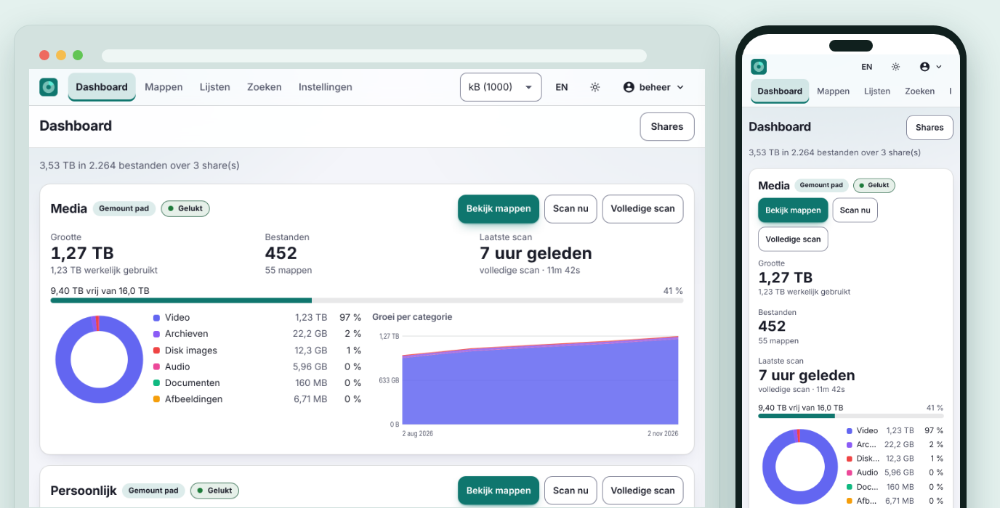
</picture>

</div>

---

## Inhoud

- [Waarom NASSA?](#waarom-nassa)
- [Wat kan het?](#wat-kan-het)
- [Zo ziet het eruit](#zo-ziet-het-eruit)
- [Snel starten](#snel-starten)
- [Gebruik](#gebruik)
- [Configuratie](#configuratie)
- [Beheer](#beheer)
- [Data en back-ups](#data-en-back-ups)
- [Architectuur](#architectuur)
- [Stabiel en beta](#stabiel-en-beta)
- [Meewerken](#meewerken)
- [Privacy en beveiliging](#privacy-en-beveiliging)
- [Steun NASSA](#steun-nassa)
- [Licentie](#licentie)

## Waarom NASSA?

Een NAS loopt langzaam vol, en op een share met miljoenen bestanden is *waar blijft de ruimte?* geen vraag die je even beantwoordt: alles opnieuw doorlopen duurt lang, en wat je de vorige keer zag, ben je kwijt. NASSA draait in Docker, op je NAS of ernaast, scant je shares alleen-lezen en bewaart van elke scan een momentopname. Je ziet wat er nu staat én wat er groeit, en een volgende scan hergebruikt de mappen die niet veranderden. Opruimen blijft jouw beslissing: NASSA verwijdert zelf niets, maar schrijft een script dat jij leest en draait.

## Wat kan het?

- **Alleen lezen**: NASSA leest van je NAS alleen metadata (`stat` en mapinhoud, nooit de inhoud van een bestand) en schrijft niets terug. De aanbevolen opzet mount je shares read-only in de container.
- **Gebouwd voor veel bestanden**: parallelle workers, grote batches naar PostgreSQL en voorberekende totalen per map, per categorie en per extensie. Op 10 miljoen bestanden blijven de weergaven onder een halve seconde, behalve twee brede leeftijdsfilters over een héle share (2,0 tot 2,6 s); de metingen staan in [`docs/bench-phase2.md`](docs/bench-phase2.md).
- **Slim scannen, op schema**: onveranderde mappen worden hergebruikt, dus een volgende scan is veel sneller. Uitsluitpatronen, symlinks worden niet gevolgd, een hardlink telt één keer, de werkelijke grootte (`st_blocks`) staat naast de logische, de IO is te begrenzen, en je ziet de voortgang live en kunt annuleren. Een cron-schema per share, met een jobstatus die een herstart overleeft. Een scan die niets vindt terwijl de vorige meer dan 100 bestanden zag (een share die niet meer gemount is) wordt geweigerd en laat je oude gegevens staan.
- **Dashboard, bestandstypes en historie**: per share de grootte, het aantal bestanden, hoeveel van de schijf vol is, een donut per bestandstype en de groei per categorie in de tijd. Elke scan is een momentopname, met een instelbare bewaartermijn. De acht categorieën (Video, Audio, Afbeeldingen, Documenten, Archieven, Code, Disk images, Overig) volgen een extensietabel die je aanpast; een wijziging werkt direct door in alle cijfers, zonder opnieuw te scannen.
- **Mappen, kaart en lijsten**: bladeren met percentages en sorteren, een treemap om in één oogopslag de grote blokken te zien, en filters die je combineert: categorie, extensie, grootte, gewijzigd, laatst gebruikt en naam. Lijsten met de grootste en de langst niet gebruikte bestanden en mappen, per share, plus zoeken op naam. CSV-export van elk overzicht.
- **Verwijderscripts**: vink bestanden en mappen aan en je krijgt één script (`.ps1`, `.cmd`, `.sh` of een eenvoudige `.txt`) dat precies die dingen verwijdert. **NASSA verwijdert zelf nooit iets**: het schrijft de tekst, jij draait hem. Zie [Verwijderen](#verwijderen).
- **Veilig inloggen, met meerdere gebruikers**: lokale accounts met Argon2id, een **verplichte tweede factor** (authenticator-app of passkey, ook wachtwoordloos met alleen een passkey), herstelcodes, lockout, CSRF-bescherming, de rollen Admin en Viewer en een auditlog. Geen standaardwachtwoorden. Een beheerder nodigt anderen uit met een eenmalige link; niemand kiest het wachtwoord van een ander.
- **Instellingen per persoon**: Nederlands of Engels, binaire of decimale eenheden, licht, donker of volgens je systeem, en een eigen accentkleur.
- **Voor beheerders**: een OpenAPI-REST-API, Prometheus-`/metrics`, JSON-logs, health checks, een back-up van wat je zelf invoerde en een fabrieksreset.
- **Jij houdt de regie**: alles draait in je eigen containers. De update-check vraagt alleen aan GitHub of er een nieuwere release is en stuurt niets over jouw installatie mee; je zet hem uit met `NASSA_UPDATE_CHECK=false`.

Hoe je elke functie gebruikt, staat onder [Gebruik](#gebruik); wat (nog) niet kan, onder [Bekende beperkingen](#bekende-beperkingen).

## Zo ziet het eruit

Elke afbeelding toont dezelfde pagina op een computer en op een telefoon.

| Dashboard | Mappen |
|:---:|:---:|
|  | 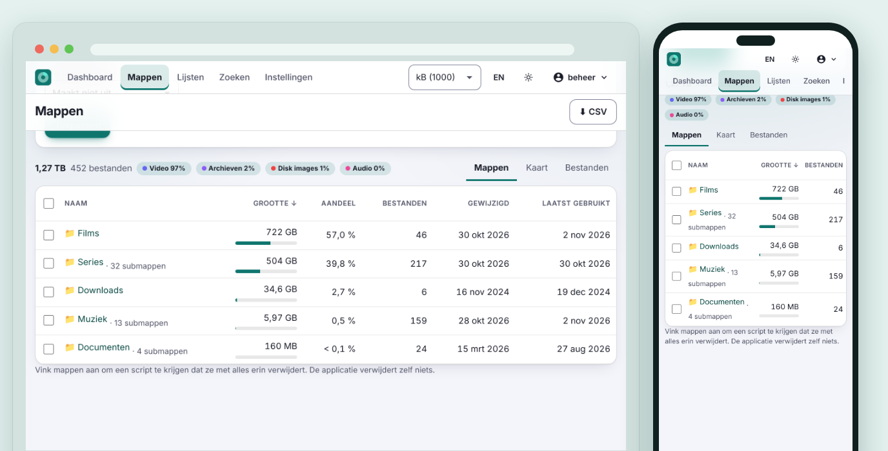 |

| Kaart | Lijsten |
|:---:|:---:|
| 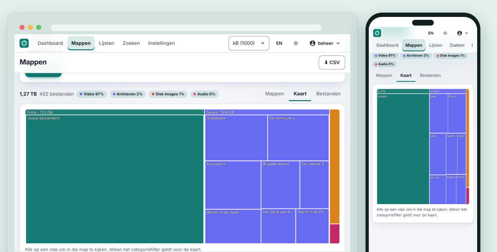 | 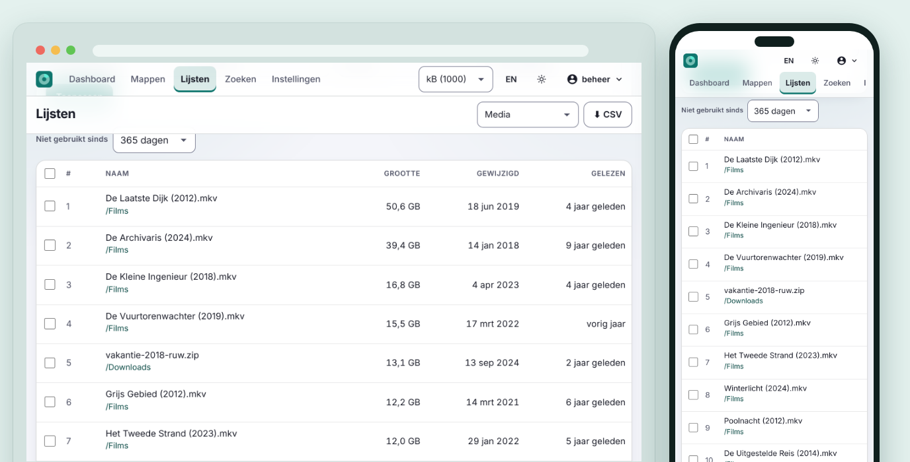 |

| Selecteren | Verwijderscript |
|:---:|:---:|
| 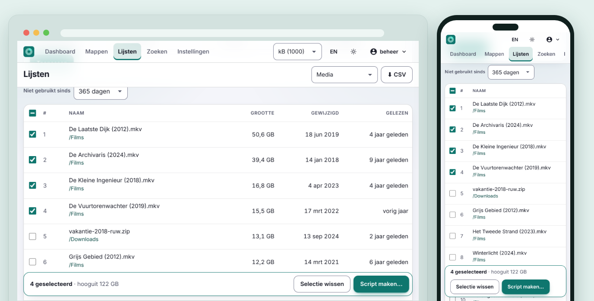 | 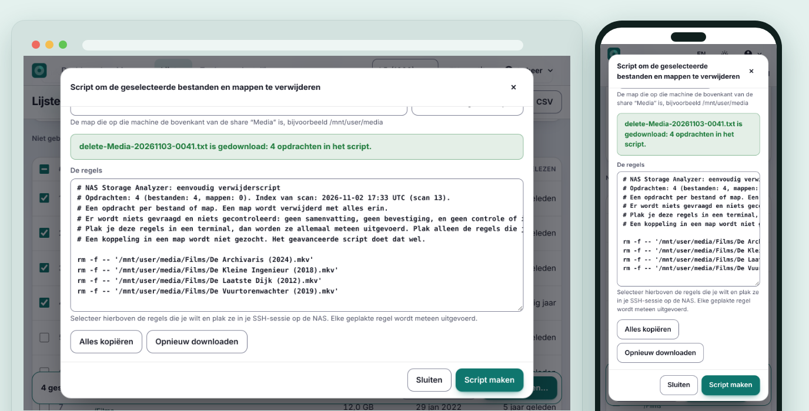 |

| Instellingen, Verwijderen | Auditlog |
|:---:|:---:|
| 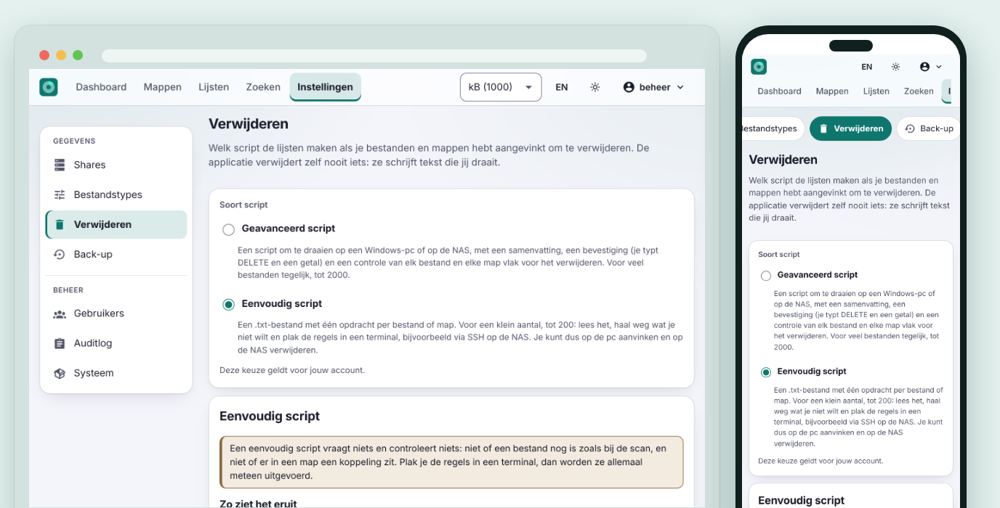 | 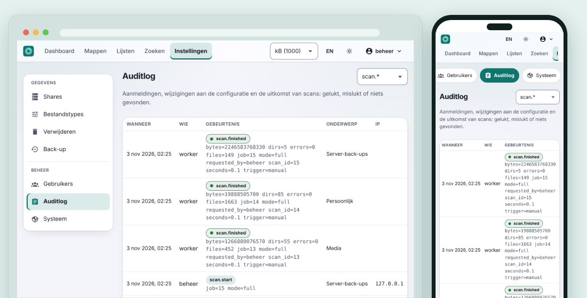 |

| Back-up | Donker thema |
|:---:|:---:|
| 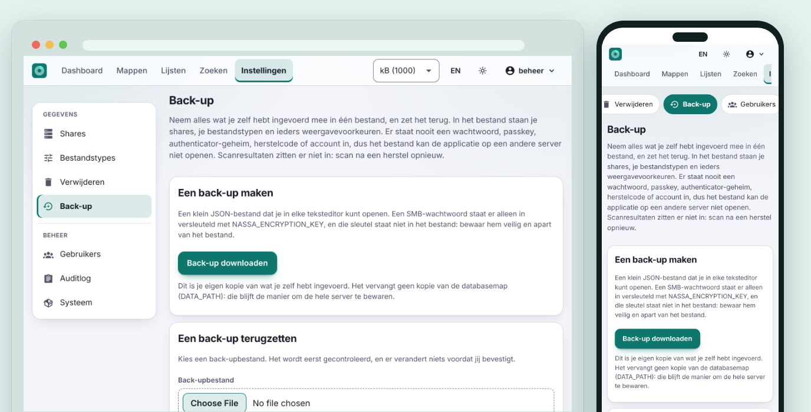 | 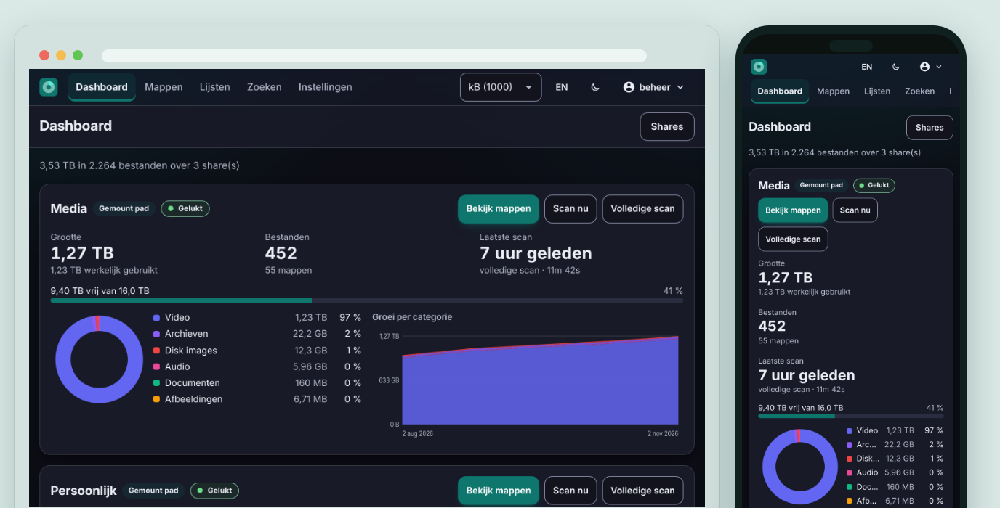 |

<sub>De schermafbeeldingen tonen voorbeeldgegevens, met speciaal aangemaakte (sparse) bestanden die er veel groter uitzien dan ze zijn. Ze komen uit [`web/e2e/screenshots.cjs`](web/e2e/screenshots.cjs) en zijn dus altijd van de echte applicatie.</sub>

## Snel starten

- 🐳 **Zelf hosten:** installeer de stack met Docker, zie [Installatie](#installatie-zelf-hosten).
- 🌐 **Web:** open daarna het adres van je eigen installatie, op een computer of een telefoon; de interface past zich aan het scherm aan.

### Installatie (zelf hosten)

Je hebt Docker met Compose v2 nodig, op de NAS zelf of op een machine die je shares kan zien.

```bash
git clone https://github.com/helmerzNL/NAS-Storage-Analyzer.git
cd NAS-Storage-Analyzer
./scripts/init-env.sh --data-path /srv/nas-storage-analyzer --shares-dir /srv/nas
docker compose up -d
```

`init-env.sh` maakt `.env` met willekeurige geheimen (database-wachtwoord, encryptiesleutel, setup-token) en de twee mappen. Het overschrijft nooit iets en weigert een relatief pad. Zonder opties kiest het `/mnt/user/appdata/nas-storage-analyzer` en `/mnt/user` op Unraid en anders `/srv/nas-storage-analyzer` en `/srv/shares`; controleer wat het koos.

De stack haalt de image op van `ghcr.io/helmerznl/nas-storage-analyzer` (voor `linux/amd64` en `linux/arm64`); op de server wordt niets gebouwd. Wil je hem toch uit deze map bouwen: `docker compose -f docker-compose.yml -f docker-compose.build.yml up -d --build`.

**Waar de data staat.** Alles wat niet verloren mag gaan (de database, in `DATA_PATH/postgres`) staat in één **absolute** map op de host: `DATA_PATH` in `.env`. Het zijn gewone mappen, geen Docker-volumes, dus `docker compose down -v`, een prune of een herbouw raakt ze niet. Een relatief pad is niet toegestaan: dat wordt opgelost door de tool die de stack start, en dat is niet altijd de host (Dockhand op Unraid loste zo'n pad bij een andere app op naar de RAM-schijf).

Open daarna <http://127.0.0.1:8080>. De app luistert standaard alleen op die machine zelf; zet je hem op een NAS en wil je erbij vanaf een ander apparaat, dan zet je `NASSA_HTTP_BIND=0.0.0.0` (en liefst een [reverse proxy](#reverse-proxy-en-https) met https ervoor).

> **Heb je NASSA al, van vóór v0.2.0?** Dan heten alle omgevingsvariabelen nu `NASSA_*` in plaats van `NASA_*` en wordt een oude `.env` geweigerd. Eén commando lost het op, zie [Bijwerken](#bijwerken).

### Eerste start

Een nieuwe installatie opent een setup-wizard; een bestaande installatie ziet hem niet.

1. **Setup-token.** Voer de `NASSA_SETUP_TOKEN` uit `.env` in. Staat er geen, dan staat een willekeurige token in het log: `docker compose logs app | grep setup_token`.
2. **Beheerder.** Kies een naam en een wachtwoord. Er zijn geen standaardwachtwoorden.
3. **Tweede factor.** Stel een authenticator-app in (je krijgt herstelcodes, één keer in beeld) of een passkey. Dat is verplicht, voor elk account.
4. **Eerste share.** Kies **Shares → Share toevoegen**, klik op **Bladeren…** en kies de map (of typ het pad), en klik op **Scan nu** op het dashboard.

Passkeys zijn aan een hostnaam gebonden en werken alleen via https of op `localhost`. Zet in productie `NASSA_RP_ID` en `NASSA_RP_ORIGINS`, zie [Reverse proxy en https](#reverse-proxy-en-https).

### Shares beschikbaar maken

NASSA leest een gewone map. Hoe die map bij de container komt, bepaal je met `NASSA_SHARES_DIR` (verplicht, een absoluut pad op de host); die verschijnt **read-only** als `/mnt/shares` in `app` en `worker`.

**Route b (aanbevolen): mount op de host.** Mount de NFS- of SMB-share read-only op de Docker-host en geef de map door. De containers hebben dan geen speciale rechten nodig en kunnen niets op de NAS wijzigen.

```bash
# /etc/fstab op de host
nas.lan:/volume1/media  /srv/nas/media  nfs  ro,vers=4.1,_netdev,x-systemd.automount,noatime  0 0
```

```bash
# .env
NASSA_SHARES_DIR=/srv/nas
```

Voeg de share in de interface toe als type *Gemount pad*: klik op **Bladeren…** en kies `/mnt/shares/media`.

**Route c: de stack draait op de NAS zelf** (bijvoorbeeld Unraid). Dan is er niets te mounten: de shares zijn gewone mappen. Geef die map door en zet `NASSA_SHARES_MOUNT` op hetzelfde pad, dan zijn de paden in de interface dezelfde als die je van de NAS kent.

```bash
# .env
NASSA_SHARES_DIR=/mnt/user
NASSA_SHARES_MOUNT=/mnt/user
```

Melden de mapkiezer of de scan *permission denied* voor een map met `drwxrwx---` voor `nobody:users`? Zet dan `NASSA_SHARES_GID=100`.

**Route a: de worker mount zelf**, met `docker compose -f docker-compose.yml -f docker-compose.mounts.yml up -d`. Dat geeft alleen de worker root, `CAP_SYS_ADMIN`, `CAP_DAC_READ_SEARCH` en `CAP_DAC_OVERRIDE` (SMB heeft ze alle drie nodig: `mount.cifs` stopt zonder een ervan met *Unable to apply new capability set* (oudere versies: *Unable to set current process capabilities*)); je vult in de interface server, export of share, versie en eventueel SMB-inloggegevens in (versleuteld opgeslagen). Deze route is getest tot en met de rechten en met een nagebootste mount-uitvoerder, maar niet tegen een echte NFS- of SMB-server. Test een nieuwe share met *Scan nu*.

Alleen wat je als share toevoegt wordt gescand. Een share die niet (meer) gemount is laat een lege map achter; een scan die dan niets vindt terwijl de vorige meer dan 100 bestanden zag, wordt geweigerd en laat de oude gegevens staan. Details, SMB-voorbeelden, AppArmor, losse Unraid-schijven en Exclusive shares: [`docs/deploy.md`](docs/deploy.md#2-shares-beschikbaar-maken).

### Unraid en Home Assistant

Waar een platform per app één container draait (de Community Applications-store van Unraid, een Home Assistant-add-on), is er een all-in-one image: `ghcr.io/helmerznl/nas-storage-analyzer-aio`, met dezelfde tags. Het draait PostgreSQL 16, de webinterface en de worker in één container en bewaart alles in `/data`. Ook daar is `NASSA_ENCRYPTION_KEY` verplicht: `docker run --rm ghcr.io/helmerznl/nas-storage-analyzer-aio genkey` maakt er een. Wil je dat de worker daar zelf SMB of NFS mount, geef de container dan `--cap-add SYS_ADMIN --cap-add DAC_READ_SEARCH` bovenop Docker's standaardrechten (voor NFS volstaat `SYS_ADMIN`; waar AppArmor de mount blokkeert komt er `--security-opt apparmor=unconfined` bij). Compose blijft de aanbevolen route; details in [`docs/deploy.md`](docs/deploy.md#8b-all-in-one-image-unraid-store-en-home-assistant) en [ADR 0013](docs/adr/0013-all-in-one-image.md).

## Gebruik

### Scannen

**Scan nu** op het dashboard scant incrementeel: mappen die niet veranderden worden hergebruikt. **Volledige scan** leest alles opnieuw (standaard gebeurt dat ook elke zevende scan). Een scan loopt in de `worker`, je ziet de voortgang live en kunt hem annuleren; een geannuleerde of mislukte scan laat de eerdere gegevens ongemoeid. Per share stel je een cron-schema en uitsluitpatronen in, het aantal parallelle workers en een begrenzing van het aantal bestandsoperaties per seconde en per dag (met een eigen dag- en nachtvenster), hoeveel scans en hoeveel dagen historie bewaard blijven, en of "laatst gebruikt" de leestijd (`atime`), de wijzigingsdatum of het maximum van beide is.

Het dashboard toont één kaart per share: hoeveel ruimte de bestanden innemen (en hoeveel er werkelijk is toegewezen), hoeveel van de schijf nog vrij is, wat de grootste bestandstypes zijn en hoe dat per categorie groeit. Een **fout bij een scan** staat erbij: de rode melding bij een mislukte scan, of de badge *N fouten* bij een scan die niet alles kon lezen. Als beheerder klik je erop en kom je direct bij het item in het auditlog, met de oorzaak, een tip en de lijst met mappen die niet gelezen konden worden.

### Bladeren en zoeken

Onder **Mappen** blader je door een share met de tabbladen *Mappen*, *Kaart* (treemap) en *Bestanden*: de mappen met hun grootte, aandeel, aantal bestanden en datums. Klik een map open, sorteer op een kolom, of klik op een vlak van de kaart om in die map te kijken; de filters (categorie, extensie, grootte, leeftijd, naam) combineer je. **Lijsten** toont de grootste en de koudste bestanden en mappen, bijvoorbeeld alles wat een jaar niet is geopend, en **Zoeken** zoekt op naam. Elk overzicht is te exporteren als CSV.

De eenheden (binair of decimaal), de taal en het thema staan bovenin naast elkaar; de themaknop wisselt tussen donker, licht en wat je apparaat zelf doet. Met de accentkleur staan ze ook onder je naam → *Weergave en taal*; ze gelden voor jouw account.

De **bestandstypes** (*Instellingen → Bestandstypes*) zijn aan te passen: een extensie naar een andere categorie verplaatsen werkt direct door in alle cijfers, zonder nieuwe scan.

### Verwijderen

Beheerders vinken bestanden en mappen aan in de lijsten en onder *Mappen*. Onderaan zie je hoeveel je aanvinkte en hoeveel ruimte dat hoogstens oplevert; **Script maken…** geeft één script. **De applicatie verwijdert zelf niets.**

- **Geavanceerd** (`.ps1`, `.cmd` of `.sh`): toont een samenvatting, vraagt `DELETE <aantal>` te typen, controleert grootte en tijd van elk bestand vlak voor het verwijderen en laat een bestand staan dat sinds de scan is veranderd. Voor veel bestanden tegelijk: hoogstens 2.000 per script. Wat het script niet veilig kan aanspreken (vreemde tekens, namen die Windows niet opent, namen die alleen in hoofdletters verschillen) laat het weg en noemt het.
- **Eenvoudig** (`.txt`): één opdracht per bestand of map (`rm`, `Remove-Item`, of `del` en `rd`), voor een klein aantal (tot 200) om te lezen, in te korten en in een terminal te plakken, bijvoorbeeld via SSH op de NAS. Het vraagt en controleert **niets**.
- **Mappen** gaan **met alles erin**. Het getal dat je typt telt ook wat de scan in die mappen vond; het script laat een map staan, en zegt dat, als hij nu meer bevat dan bij de scan of een koppeling. De share zelf wordt nooit verwijderd, en `cmd` neemt geen mappen.

Onder *Instellingen → Verwijderen* kies je welke van de twee de lijsten maken. Waar jouw machine de share ziet (`\\nas\media`, `Z:\`, `/mnt/user/media`) stel je per share in. Zie [ADR 0006](docs/adr/0006-delete-scripts.md), [ADR 0010](docs/adr/0010-delete-scripts-take-folders.md) en [ADR 0011](docs/adr/0011-simple-delete-scripts.md).

### Gebruikers en uitnodigingen

Niemand kiest het wachtwoord van iemand anders. Een beheerder maakt onder **Instellingen → Gebruikers** een **uitnodigingslink** (de rol kies jij) en geeft hem door; de gast kiest zelf een wachtwoord of een passkey. De link staat één keer in beeld, werkt één keer, verloopt na 7 dagen en wordt nergens bewaard (alleen de hash). *Nieuwe inlog-link* haalt iemand terug die niet meer kan inloggen. `NASSA_PUBLIC_URL` is het adres waar de links naartoe wijzen. Details en grenzen: [`docs/deploy.md` §4b](docs/deploy.md#4b-gebruikers-uitnodigen).

## Configuratie

In `.env`; [`.env.example`](.env.example) beschrijft elke waarde. De belangrijkste:

| Variabele | Verplicht | Standaard | Omschrijving |
|---|:---:|---|---|
| `DATA_PATH` | ✅ | - | Absolute map op de host met alles wat bewaard moet blijven; de database staat in `DATA_PATH/postgres`. Nooit relatief, nooit een Docker-volume. |
| `NASSA_TAG` | ❌ | `latest` | Welke image: `latest` (stabiel), `beta` of een versienummer. Wordt ook in de container gezet; een beta-build toont een **beta**-label. |
| `NASSA_DB_PASSWORD`, `NASSA_ENCRYPTION_KEY` | ✅ | - | Gemaakt door `scripts/init-env.sh`. De sleutel versleutelt SMB-wachtwoorden; bewaar hem bij je back-up. |
| `NASSA_SETUP_TOKEN` | ❌ | willekeurig, in het log van `app` | Nodig om de eerste beheerder aan te maken. |
| `NASSA_SHARES_DIR` | ✅ | - | Absolute map op de host met de gemounte shares (read-only in de containers). |
| `NASSA_SHARES_MOUNT` | ❌ | `/mnt/shares` | Waar die map in de containers komt, en dus het pad dat je in de interface typt. Zet het gelijk aan `NASSA_SHARES_DIR` en de paden zijn overal hetzelfde. |
| `NASSA_SHARES_GID` | ❌ | `10001` | Groep waar de containers lid van worden om shares te lezen die alleen voor de eigenaar en één groep leesbaar zijn (Unraid: `100`). |
| `NASSA_HTTP_BIND`, `NASSA_HTTP_PORT` | ❌ | `127.0.0.1`, `8080` | Waar `app` luistert; standaard alleen op de machine zelf. |
| `NASSA_TRUSTED_PROXIES`, `NASSA_REQUIRE_HTTPS` | ❌ | leeg, `false` | Achter een reverse proxy: welke proxy's `X-Forwarded-*` mogen zetten, en https afdwingen. |
| `NASSA_RP_ID`, `NASSA_RP_ORIGINS`, `NASSA_PUBLIC_URL` | ❌ | leeg | Passkeys zijn aan een hostnaam gebonden, en uitnodigingslinks hebben een adres nodig; zet ze in productie. |
| `NASSA_METRICS_TOKEN` | ❌ | leeg | Bearer-token voor `/metrics`; zonder token alleen vanaf loopback. |
| `NASSA_UPDATE_CHECK` | ❌ | `true` | `false` zet de update-check uit. |
| `NASSA_TZ` | ❌ | `Europe/Amsterdam` | Tijdzone voor cron-schema's en het dag/nacht-venster. |
| `PG_*` | ❌ | zie `.env.example` | PostgreSQL afstellen op het beschikbare geheugen. |

**Geheimen** staan in `.env` of, liever, in Docker secrets (`./scripts/init-env.sh --secrets`). De meeste `NASSA_*`-instellingen kennen een `_FILE`-variant. `.env` hoort nooit in git; alleen `.env.example` (zonder geheimen) staat in de repository.

Het commando heet nog `nasa` (`nasa serve`, `nasa scan`, …), en de standaardnaam en -gebruiker van de database ook; alleen de omgevingsvariabelen heten `NASSA_*` (zie [ADR 0012](docs/adr/0012-nassa-environment-variables.md)).

### Reverse proxy en https

Zet NASSA achter https zodra hij buiten je eigen machine bereikbaar is: cookies worden dan `Secure` en passkeys werken alleen via https of `localhost`. Voorbeeld met Caddy:

```caddyfile
nas.example.com {
    reverse_proxy 127.0.0.1:8080 {
        flush_interval -1      # live scanvoortgang (server-sent events)
    }
}
```

```bash
# .env
NASSA_TRUSTED_PROXIES=127.0.0.1
NASSA_REQUIRE_HTTPS=true
NASSA_RP_ID=nas.example.com
NASSA_RP_ORIGINS=https://nas.example.com
```

Voorbeelden voor nginx en Traefik en uitleg over `X-Forwarded-*`: [`docs/deploy.md`](docs/deploy.md#3-reverse-proxy-en-https).

## Beheer

| Taak | Commando |
|---|---|
| Starten | `docker compose up -d` |
| Stoppen | `docker compose down` (de data in `DATA_PATH` blijft staan) |
| Bijwerken | `docker compose pull && docker compose up -d` |
| Terug naar de vorige versie | zet `NASSA_TAG` op het vorige versienummer, dan `docker compose pull && docker compose up -d` (zie [Bijwerken](#bijwerken)) |
| Logboek | `docker compose logs -f app worker` |
| Status | `docker compose ps` toont `(healthy)` voor `app`, `worker` en `db` |

- **Health check:** `GET /healthz` antwoordt `200` met `ok` zodra `app` draait; `GET /readyz` antwoordt `200` met `ready` als ook de database antwoordt (dat gebruikt de Compose-health-check). De `worker` heeft een eigen `/healthz` op poort 8081 binnen de container. Alle endpoints: [`docs/operations.md`](docs/operations.md#2-health-check-endpoints).
- **Grootste upload:** 8 MiB, voor het terugzetten van een back-up; elk ander verzoek is hoogstens 64 KiB. Wat voor de app staat (een reverse proxy, een CDN) moet minstens zoveel toelaten, en voor de CSV-export en de live scanvoortgang ook buffering uitzetten en lange time-outs toestaan: [`docs/operations.md`](docs/operations.md#6-limits-that-live-outside-the-repository).
- **Updatecheck:** de beheerder krijgt een melding (een banner en het scherm *Over*) als er een nieuwere release is; de app werkt zichzelf nooit bij.

### Bijwerken

```bash
docker compose pull
docker compose up -d
```

Een stackmanager (Dockhand, Komodo, Portainer) heeft daar meestal een eigen *pull*- of *update*-actie voor. **Opnieuw uitrollen haalt een bewegende tag (`latest`, `beta`) niet vanzelf op**: pull dus eerst. Controleer wat er draait met het scherm **Over** of `curl -s http://<host>:8080/api/v1/version`. Migraties draaien bij het starten; maak vooraf een back-up. Terug naar een vorige versie: zet `NASSA_TAG` op dat versienummer en herstel de back-up van vóór de update als de [releasenotes](docs/releases/) zeggen dat het schema niet compatibel is.

**Eenmalig, van vóór v0.2.0: de variabelen heten `NASSA_` in plaats van `NASA_`.** Een `.env` met de oude namen wordt geweigerd (Compose en de app noemen de nieuwe naam), in plaats van stil de standaardwaarden te gebruiken. Pas het bestand eenmalig aan, en in een stackmanager de variabelen daar ook (bij Dockhand staat het in `.env.dockhand`):

```bash
sed -i 's/^NASA_/NASSA_/' .env
```

`DATA_PATH` en `PG_*` heten nog hetzelfde; het commando `nasa`, de database en de metrics veranderden niet, dus bestaande data en dashboards blijven werken. Staat je database nog in het volume `db-data` (een versie van vóór `DATA_PATH`)? Verplaats hem dan eenmalig, vóór je uitrolt: [`docs/deploy.md` §8](docs/deploy.md#8-bijwerken).

### Problemen oplossen

| Symptoom | Oorzaak en oplossing |
|---|---|
| `docker compose up` meldt dat `NASSA_SHARES_DIR` ontbreekt, of een variabele met `NASA_` | Een `.env` van vóór v0.2.0: `sed -i 's/^NASA_/NASSA_/' .env`. |
| **Bladeren…** toont "Geen mappen gevonden", of de scan vindt niets | De share-map is leeg in de container: er is niets gemount, of `NASSA_SHARES_DIR` wijst naar een andere map dan je denkt (of is relatief). Het auditlog toont dan `scan.empty`. |
| Scan mislukt met "permission denied" | De container draait als uid 10001 en is niet de eigenaar van de map. Zet `NASSA_SHARES_GID` op de groep die de share bezit (Unraid: `100`). |
| Het scherm vraagt om een setup-token die je niet hebt | `docker compose logs app \| grep setup_token`, of `NASSA_SETUP_TOKEN` in `.env`. |
| Passkeys werken niet ("Passkeys hebben een beveiligd adres nodig") | Open de app via een hostnaam met https (of `http://localhost`) en stel `NASSA_RP_ID` in. |
| Een scanfout op het dashboard | Klik erop (beheerder): het auditlog toont de oorzaak en de mappen die niet te lezen waren. |
| `/metrics` geeft 401 of 403 | Zet `NASSA_METRICS_TOKEN` en stuur hem mee; zonder token antwoordt alleen loopback. |
| `worker` blijft `unhealthy` | `docker compose logs worker`: meestal is de database niet bereikbaar. |

Alle symptomen: [`docs/deploy.md`](docs/deploy.md#10-problemen-oplossen).

## Data en back-ups

Alles staat onder `DATA_PATH`:

| Map | Wat erin staat |
|---|---|
| `postgres` | De PostgreSQL-database: de bestandsindex, de voorberekende totalen, de historie, de shares, de accounts en de instellingen. |

De encryptiesleutel `NASSA_ENCRYPTION_KEY` staat buiten de database, in `.env` of een Docker secret. Er zijn twee soorten back-up:

- **In de app** (*Instellingen → Back-up*, beheerders): wat je zelf invoerde (shares, bestandstypes, ieders weergavevoorkeuren) als één klein JSON-bestand, terug te zetten na een controle die niets verandert voordat jij bevestigt. Er staat nooit een wachtwoord, passkey, authenticator-geheim, herstelcode, account of rol in; een SMB-wachtwoord alleen versleuteld met `NASSA_ENCRYPTION_KEY`, die niet in het bestand zit. Scanresultaten zitten er niet in (scan opnieuw na een herstel). Het vervangt geen kopie van de database.
- **De hele database**, met `pg_dump`:

  ```bash
  docker compose exec -T db sh -c 'pg_dump -U "$POSTGRES_USER" -d "$POSTGRES_DB" -Fc' > nassa-$(date +%F).dump
  ```

  Herstellen: `docker compose up -d db`, dan `docker compose exec -T db sh -c 'pg_restore -U "$POSTGRES_USER" -d "$POSTGRES_DB" --clean --if-exists --no-owner' < nassa-….dump`, dan `docker compose up -d`. Bewaar `NASSA_ENCRYPTION_KEY` bij de dump: zonder de sleutel zijn de opgeslagen SMB-wachtwoorden niet te ontsleutelen. Een kopie van `DATA_PATH/postgres` terwijl de database gestopt is, werkt ook. Het volledige stappenplan: [`docs/deploy.md`](docs/deploy.md#5-back-up-en-herstel).

*Instellingen → Systeem → Fabrieksreset* zet de installatie terug naar nieuw (alle tabellen leeg, de wizard begint opnieuw); je typt `RESET` en bewijst opnieuw wie je bent. Je bestanden op de NAS blijven onaangeroerd.

## Architectuur

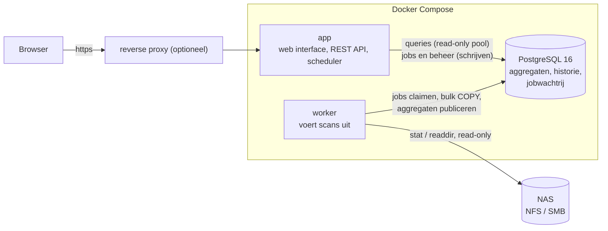

| Onderdeel | Doel | Gegevens |
|---|---|---|
| `app` | Serveert de interface (in de binary ingebakken), de REST API en de scheduler. Hij scant niet en draait zonder rechten. Alleen voor de mapkiezer leest hij (read-only, alleen voor beheerders) de namen van mappen onder de share-map; bestanden worden niet getoond of geopend. | Geen eigen gegevens |
| `worker` | Haalt scanjobs uit de wachtrij in de database (`FOR UPDATE SKIP LOCKED`), scant, en publiceert het resultaat in één transactie. Alleen de worker scant de NAS, en in de aanbevolen opzet alleen via een read-only bind-mount. | Geen eigen gegevens; leest de share |
| `db` (PostgreSQL 16) | De bestandsindex (per share een eigen partitie, mappen als `ltree`) en de voorberekende totalen per map, per map en categorie, en per extensie, plus de historie, de accounts en de jobwachtrij. Daardoor lezen de meeste weergaven een paar duizend rijen in plaats van alle bestanden. | `DATA_PATH/postgres` |
| de NAS-share | Wat er gemeten wordt | Wordt nooit beschreven |

Het volledige ontwerp en de afwegingen: [`docs/ontwerp.md`](docs/ontwerp.md). De REST API is beschreven in [`api/openapi.yaml`](api/openapi.yaml) en wordt door `app` op `/openapi.yaml` geserveerd; contracttests valideren elk antwoord tegen de specificatie. Hoe de app de app-engineeringonderwerpen beantwoordt: [`docs/app-engineering-conformance.md`](docs/app-engineering-conformance.md).

### Bekende beperkingen

- **atime is vaak onbetrouwbaar.** Veel NAS-systemen en netwerkmounts werken de leestijd niet bij. De scanner meet per scan hoe betrouwbaar atime lijkt en de interface waarschuwt bij "niet gebruikt sinds"; per share kies je atime, wijzigingsdatum of het maximum van beide. "Laatst gebruikt" blijft een schatting.
- **Incrementele scans** hergebruiken een map als `mtime` en aantal entries gelijk zijn. Een bestand dat in place groeit en een nieuwe hardlink in een ongewijzigde map worden pas bij de volgende volledige scan gezien (standaard elke zevende; ook met één klik).
- Twee brede leeftijdsfilters over een héle share van 10 miljoen bestanden duren 2,0 tot 2,6 s; alle andere weergaven blijven onder 500 ms.
- Eén directory wordt in één keer gelezen; een map met miljoenen entries kost merkbaar geheugen in de worker.
- **Verwijderscripts** zijn alleen zo goed als de index. Ze controleren grootte en tijd vóór het verwijderen, maar een bestand dat sinds de scan is vervangen door een ander van gelijke grootte en tijd is niet te onderscheiden. Bij een map controleert het script aantallen, niet elk bestand. Het eenvoudige script controleert niets.
- Geen OIDC; de auth-laag is zo opgezet dat een extra inlogmethode een sessie kan aanmaken, maar de koppeling is niet gebouwd.

Alle beperkingen met toelichting: [`docs/deploy.md`](docs/deploy.md#9-bekende-beperkingen).

## Stabiel en beta

| | Stabiel | Beta |
|---|---|---|
| Branch | `main` | `beta` |
| Image | `ghcr.io/helmerznl/nas-storage-analyzer:latest` (en `X.Y.Z`) | `ghcr.io/helmerznl/nas-storage-analyzer:beta` (en `beta-<sha>`) |
| GitHub-release | `vX.Y.Z` | `vX.Y.Z-beta.N`, pre-release |

Elke wijziging komt eerst in de **beta**; alleen een bewuste promotie van `beta` naar `main` maakt er een stabiele versie van. Welke image draait, kies je met `NASSA_TAG`:

| `NASSA_TAG` | Wat je krijgt |
|---|---|
| `latest` | De stabiele lijn. Wordt gepubliceerd als `beta` wordt gepromoveerd naar `main`. |
| `beta` | De build waar elke wijziging eerst in landt; de interface toont een **beta**-label. Gebruik een aparte `DATA_PATH`. |
| `0.3.1` (een versienummer) | Blijft staan tot je het wijzigt. |

Elke stabiele versie staat onder [Releases](https://github.com/helmerzNL/NAS-Storage-Analyzer/releases). Wat er per versie veranderde, staat in de [releasenotes](docs/releases/), in het Nederlands en het Engels.

## Meewerken

Bijdragen zijn welkom. Pull requests gaan naar de branch `beta`, nooit naar `main`; `main` krijgt alleen een promotie-PR vanuit `beta`. De werkafspraken voor mensen en AI-hulpen staan in [`AGENTS.md`](AGENTS.md). Pull requests wijzigen `VERSION` niet, dat doet de pipeline. Activeer na het clonen de hooks met `python scripts/setup_hooks.py`. Wat een operator nodig heeft (starten, health checks, limieten voor een proxy, back-up): [`docs/operations.md`](docs/operations.md). Voor fouten en ideeën open je een [issue](https://github.com/helmerzNL/NAS-Storage-Analyzer/issues/new/choose).

```bash
cd web && npm ci && npm run build && cd ..     # de interface wordt in de Go-binary ingebakken
go build -o nasa ./cmd/nasa                    # subcommando's: serve, worker, scan, migrate, recategorize, genkey, healthcheck, version
```

```bash
go vet ./... && go test ./...                  # unit tests; databasetests worden overgeslagen zonder database
NASSA_TEST_DSN='postgres://user@host/postgres' NASSA_REQUIRE_DB=1 go test -race ./...   # met PostgreSQL 16: elke test krijgt een eigen database
cd web && npm run check && npx vitest run      # typecontrole en unit tests van de interface
```

De **browsertest** (`web/e2e`) start een database, `serve` en `worker` en doorloopt met een echte Chromium de hele applicatie: setup-wizard, authenticator-app, herstelcodes, passkeys (virtuele authenticator), share toevoegen, scannen door de worker, bladeren, filters, treemap, lijsten, zoeken, CSV, gebruikers en auditlog:

```bash
npm install -g playwright && playwright install chromium     # eenmalig; de test gebruikt de globale installatie
sh web/e2e/run.sh ./nasa postgres://user@127.0.0.1:5432      # vanuit de hoofdmap; `psql` moet beschikbaar zijn
```

**De screenshots** in deze README maakt hetzelfde raamwerk, met voorbeeldgegevens: `NASSA_UPDATE_CHECK=false E2E_SCRIPT=screenshots.cjs sh web/e2e/run.sh ./nasa postgres://user@127.0.0.1:5432` schrijft `docs/screenshots/nl` en `docs/screenshots/en`. Pas de PNG's nooit met de hand aan: wijzig het script en draai het opnieuw. `scripts/test_readme.py` bewaakt dat beide README's dezelfde opbouw houden en dat elke link en afbeelding bestaat.

De prestatiemeting op 10 miljoen bestanden:

```bash
go build -o nasabench ./cmd/nasabench
NASSA_DB_DSN=postgres://user@host/bench ./nasabench seed -files 10000000 -dirs 200000
NASSA_DB_DSN=postgres://user@host/bench ./nasabench queries -runs 20 -out rapport.md
```

Scannen zonder interface kan ook: `nasa scan -path /mnt/shares/media -name media -exclude .snapshot` (zie `nasa scan -h`; `-dry-run` scant zonder database).

## Privacy en beveiliging

- **Alles staat op je eigen server**: geen account bij ons, geen analytics, geen tracking. De enige verbinding naar buiten is de update-check: die vraagt aan `github.com` of er een nieuwere release is, met alleen een vaste `User-Agent` (geen versie, geen installatie-id, geen gebruikersgegevens), en werkt niets bij.
- **Lokale accounts** met Argon2id, lockout na mislukte pogingen en CSRF-bescherming. Een **tweede factor is verplicht**: een authenticator-app (met herstelcodes) of een passkey, die ook wachtwoordloos inloggen kan.
- **Rollen:** Admin en Viewer. Alleen beheerders maken verwijderscripts, beheren shares, gebruikers en bestandstypes en zien het auditlog.
- **Auditlog** van aanmeldingen, wijzigingen aan de configuratie en de uitkomst van elke scan (gelukt, mislukt of niets gevonden).
- **Alleen-lezen.** De containers draaien zonder rechten (`read_only`, `cap_drop: ALL`, `no-new-privileges`) en de shares zijn read-only gemount. Alleen route a geeft de worker meer rechten.
- Meld een kwetsbaarheid vertrouwelijk via een [beveiligingsadvies](https://github.com/helmerzNL/NAS-Storage-Analyzer/security/advisories/new), nooit in een openbaar issue. Wat ondersteund wordt en hoe het project zijn afhankelijkheden en images bewaakt, staat in [`SECURITY.md`](SECURITY.md).

## Steun NASSA

NASSA is gratis. Heb je er iets aan? Met een koffie houd je de ontwikkeling gaande.

<a href="https://buymeacoffee.com/flux76"></a>
<a href="https://ko-fi.com/flux76"></a>

## Licentie

Er is nog geen licentie gekozen: alle rechten voorbehouden.

### Onderdelen

NASSA is gebouwd met Go 1.27 en Svelte 5, op PostgreSQL 16. De directe afhankelijkheden:

| Onderdeel | Waarvoor | Licentie |
|---|---|---|
| [pgx](https://github.com/jackc/pgx) | PostgreSQL-driver | MIT |
| [kin-openapi](https://github.com/getkin/kin-openapi) | Elk verzoek en antwoord controleren tegen `api/openapi.yaml` | MIT |
| [go-webauthn](https://github.com/go-webauthn/webauthn) | Passkeys | BSD-3-Clause |
| [pquerna/otp](https://github.com/pquerna/otp) | Authenticator-codes (TOTP) | Apache-2.0 |
| [client_golang](https://github.com/prometheus/client_golang) | Prometheus-metrics | Apache-2.0 |
| [golang.org/x/crypto](https://pkg.go.dev/golang.org/x/crypto), [x/sys](https://pkg.go.dev/golang.org/x/sys), [x/time](https://pkg.go.dev/golang.org/x/time) | Argon2id, systeemaanroepen, snelheidsbegrenzing | BSD-3-Clause |
| [Svelte](https://svelte.dev), [Vite](https://vite.dev), [TypeScript](https://www.typescriptlang.org), [Vitest](https://vitest.dev) | De interface en de tests | MIT, MIT, Apache-2.0, MIT |
| [qrcode-generator](https://github.com/kazuhikoarase/qrcode-generator) | De QR-code voor de authenticator-app | MIT |
| [Material Design Icons](https://pictogrammers.com/library/mdi/) (Pictogrammers) | De pictogrammen; ze zitten in de applicatie, er wordt niets bij een derde partij geladen | Apache-2.0 |
| [PostgreSQL](https://www.postgresql.org) | De database (image `postgres:16-alpine`) | PostgreSQL License |

De licenties zijn die van de gebruikte versies; kijk in de repository van een onderdeel voor de volledige tekst.

---

<div align="center">
<sub>Met ❤️ gemaakt in Nederland door <a href="https://flux76.com">Flux76</a></sub>
</div>
