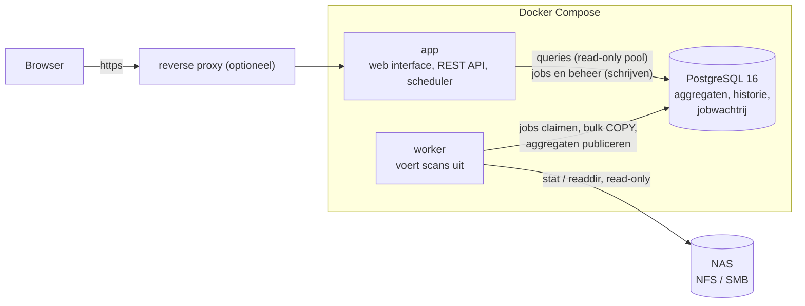

# NAS Storage Analyzer

Self-hosted tool die NFS/SMB-shares **read-only** scant en laat zien hoeveel ruimte data inneemt: per share,
per map en per bestandstype. Gebouwd voor shares met miljoenen bestanden en tientallen terabytes: de scanner leest
alleen metadata, schrijft grote batches naar PostgreSQL en houdt voorberekende totalen bij, zodat elke weergave
snel blijft.

* **Scanner**: parallelle workers, alleen metadata (`stat` en directory-listings, nooit bestandsinhoud),
  incrementeel (onveranderde mappen worden hergebruikt), uitsluitpatronen, symlinks niet gevolgd, hardlinks één keer
  geteld, werkelijke grootte (`st_blocks*512`) naast logische grootte, IO-begrenzing, annuleren, live voortgang.
* **Weergave**: dashboard met donut en groeigrafiek, mappenbrowser met percentages en sorteren, treemap, combineerbare
  filters (categorie, extensie, grootte, gewijzigd, laatst gebruikt, naam), grootste en koudste bestanden en mappen,
  zoeken, CSV-export.
* **Bestandstypes** in acht categorieën (Video, Audio, Afbeeldingen, Documenten, Archieven, Code, Disk images, Overig)
  met een aanpasbare extensietabel; een wijziging werkt direct door in alle cijfers, zonder opnieuw te scannen.
* **Historie**: per scan een momentopname, met instelbare bewaartermijn; groei per categorie in de tijd.
* **Beveiliging**: lokale accounts met Argon2id, **verplichte tweede factor** (authenticator-app of passkey, ook
  wachtwoordloos met alleen een passkey), herstelcodes, lockout, CSRF-bescherming, rollen Admin en Viewer, auditlog,
  setup-wizard zonder standaardwachtwoorden.
* **Beheer**: scheduler met cron per share (persistente jobstatus), OpenAPI-REST-API, Prometheus-`/metrics`, JSON-logs,
  health checks. Interface in Nederlands en Engels, binaire of decimale eenheden, donkere modus.

## Snel starten

Vereist: Docker met Compose v2.

```bash
git clone https://github.com/helmerzNL/NAS-Storage-Analyzer.git
cd NAS-Storage-Analyzer
./scripts/init-env.sh              # maakt .env met willekeurige geheimen (database-wachtwoord, encryptiesleutel, setup-token)
docker compose up -d --build
```

Open <http://127.0.0.1:8080>, voer de setup-token uit `.env` in, maak het beheerdersaccount aan en stel de tweede
factor in. Voeg daarna een share toe (**Shares → Share toevoegen**) en klik op **Scan nu** op het dashboard.

Zet in `.env` `NASA_SHARES_DIR` op de map op de Docker-host waar je NAS-shares gemount zijn; die verschijnt
read-only als `/mnt/shares` in de containers. Zie [Shares beschikbaar maken](#shares-beschikbaar-maken).

## Architectuur



* **`app`** serveert de interface (in de binary ingebakken), de REST API en de scheduler. Hij heeft geen toegang
  tot de NAS nodig en draait zonder rechten.
* **`worker`** haalt scanjobs uit de wachtrij in de database (`FOR UPDATE SKIP LOCKED`), scant, en publiceert het
  resultaat in één transactie; een geannuleerde of mislukte scan laat de eerdere gegevens ongemoeid. Alleen de
  worker raakt de NAS aan, en alleen in de aanbevolen opzet via een read-only bind-mount.
* **PostgreSQL** bewaart de bestandsindex (per share een eigen partitie, mappen als `ltree`) en de voorberekende
  totalen per map, per map en categorie, en per extensie. Daardoor lezen de meeste weergaven een paar duizend
  rijen in plaats van alle bestanden. Metingen op 10 miljoen bestanden: [`docs/bench-phase2.md`](docs/bench-phase2.md).

Het volledige ontwerp en de afwegingen staan in [`docs/ontwerp.md`](docs/ontwerp.md).

## Shares beschikbaar maken

Aanbevolen (**route b**): mount de NFS- of SMB-share op de Docker-host, read-only, en geef die map door:

```bash
# /etc/fstab op de host
nas.lan:/volume1/media  /srv/nas/media  nfs  ro,vers=4.1,_netdev,x-systemd.automount,noatime  0 0
```
```bash
# .env
NASA_SHARES_DIR=/srv/nas
```

Voeg de share in de interface toe als type *Gemount pad* met het pad `/mnt/shares/media`. De containers kunnen dan
niets op de NAS wijzigen en hebben geen speciale rechten nodig.

Gebruik voor `NASA_SHARES_DIR` een **absoluut pad** op de host (op Unraid bijvoorbeeld `/mnt/user`): de standaard
`./shares` is een lege map in de stackmap. Zie
[Unraid, Portainer, Dockge](docs/deploy.md#unraid-portainer-dockge-en-andere-stack-managers).

Alternatief (**route a**): de worker mount zelf, met `docker compose -f docker-compose.yml -f docker-compose.mounts.yml up -d`.
Dat geeft alleen de worker root en `CAP_SYS_ADMIN`. Je vult dan in de interface server, export of share, versie en
eventueel SMB-inloggegevens in (versleuteld opgeslagen). Details, SMB-voorbeelden, AppArmor en late mounts:
[`docs/deploy.md`](docs/deploy.md#2-shares-beschikbaar-maken).

> Route a is in de ontwikkelomgeving getest tot en met de rechten en met een nagebootste mount-uitvoerder, maar niet
> tegen een echte NFS- of SMB-server. Test een nieuwe share met *Scan nu* en lees zo nodig de melding op het dashboard.

Een share die niet (meer) gemount is, laat een lege map achter. Een scan die dan niets vindt terwijl de vorige
meer dan 100 bestanden zag, wordt geweigerd en laat de oude gegevens staan.

## Configuratie

Alle instellingen staan met uitleg in [`.env.example`](.env.example). De belangrijkste:

| Variabele | Betekenis |
|---|---|
| `NASA_DB_PASSWORD`, `NASA_ENCRYPTION_KEY` | Vereist. Gemaakt door `scripts/init-env.sh`. De sleutel versleutelt SMB-wachtwoorden; bewaar hem bij je back-up. |
| `NASA_SETUP_TOKEN` | Nodig om de eerste beheerder aan te maken (anders staat een willekeurige token in het log van `app`). |
| `NASA_SHARES_DIR` | Map op de host met de gemounte shares (read-only, als `/mnt/shares` in de containers). |
| `NASA_HTTP_BIND`, `NASA_HTTP_PORT` | Waar `app` luistert; standaard alleen `127.0.0.1:8080`. |
| `NASA_TRUSTED_PROXIES`, `NASA_REQUIRE_HTTPS` | Achter een reverse proxy: welke proxy's `X-Forwarded-*` mogen zetten, en https afdwingen. |
| `NASA_RP_ID`, `NASA_RP_ORIGINS` | Passkeys zijn aan een hostnaam gebonden; zet deze in productie. |
| `NASA_METRICS_TOKEN` | Bearer-token voor `/metrics`; zonder token alleen vanaf loopback. |
| `NASA_TZ` | Tijdzone voor cron-schema's en het dag/nacht-venster. |
| `PG_*` | PostgreSQL afstellen op het beschikbare geheugen. |

Wil je het wachtwoord en de sleutel niet als omgevingsvariabele, gebruik dan Docker secrets:
`./scripts/init-env.sh --secrets` en `docker compose -f docker-compose.yml -f docker-compose.secrets.yml up -d`.
De meeste `NASA_*`-instellingen, waaronder het database-wachtwoord en de encryptiesleutel, accepteren ook een `_FILE`-variant (bijvoorbeeld `NASA_DB_PASSWORD_FILE`).

## Reverse proxy

Zet de app achter https zodra hij buiten je eigen host bereikbaar is (cookies worden dan `Secure`, en passkeys
werken alleen via https of `localhost`). Voorbeeld met Caddy:

```caddyfile
nas.example.com {
    reverse_proxy 127.0.0.1:8080 {
        flush_interval -1      # live scanvoortgang (server-sent events)
    }
}
```

```bash
# .env
NASA_TRUSTED_PROXIES=127.0.0.1
NASA_REQUIRE_HTTPS=true
NASA_RP_ID=nas.example.com
NASA_RP_ORIGINS=https://nas.example.com
```

Voorbeelden voor nginx en Traefik en uitleg over `X-Forwarded-*`: [`docs/deploy.md`](docs/deploy.md#3-reverse-proxy-en-https).

## Back-up en herstel

Alles staat in PostgreSQL, plus de encryptiesleutel buiten de database.

```bash
docker compose exec -T db sh -c 'pg_dump -U "$POSTGRES_USER" -d "$POSTGRES_DB" -Fc' > nasa-$(date +%F).dump
```

Herstellen: `docker compose up -d db`, dan
`docker compose exec -T db sh -c 'pg_restore -U "$POSTGRES_USER" -d "$POSTGRES_DB" --clean --if-exists --no-owner' < nasa-….dump`,
dan `docker compose up -d`. Het volledige stappenplan en wat je wel en niet hoeft te bewaren:
[`docs/deploy.md`](docs/deploy.md#5-back-up-en-herstel).

## Bekende beperkingen

* **atime is vaak onbetrouwbaar.** Veel NAS-systemen en netwerkmounts werken de leestijd niet bij. De scanner meet
  per scan hoe betrouwbaar atime lijkt en de interface waarschuwt bij "niet gebruikt sinds"; per share kies je
  atime, wijzigingsdatum of het maximum van beide. "Laatst gebruikt" blijft een schatting.
* **Incrementele scans** hergebruiken een map als `mtime` en aantal entries gelijk zijn. Een bestand dat in place
  groeit en een nieuwe hardlink in een ongewijzigde map worden pas bij de volgende volledige scan gezien
  (standaard elke zevende; ook met één klik).
* Twee brede leeftijdsfilters over een héle share van 10 miljoen bestanden duren 2,0–2,6 s; alle andere weergaven
  blijven onder 500 ms.
* Eén directory wordt in één keer gelezen; een map met miljoenen entries kost merkbaar geheugen in de worker.
* Geen OIDC; de auth-laag is zo opgezet dat een extra inlogmethode een sessie kan aanmaken, maar de koppeling is niet gebouwd.

Alle beperkingen met toelichting: [`docs/deploy.md`](docs/deploy.md#9-bekende-beperkingen).

## Ontwikkelen en testen

```bash
cd web && npm ci && npm run build && cd ..     # de interface wordt in de Go-binary ingebakken
go build -o nasa ./cmd/nasa                    # subcommando's: serve, worker, scan, migrate, recategorize, genkey, healthcheck, version
```

```bash
go vet ./... && go test ./...                  # unit tests; databasetests worden overgeslagen zonder database
NASA_TEST_DSN='postgres://user@host/postgres' NASA_REQUIRE_DB=1 go test -race ./...   # met PostgreSQL 16: elke test krijgt een eigen database
cd web && npm run check && npx vitest run      # typecontrole en unit tests van de interface
```

De **browsertest** (`web/e2e`) start een database, `serve` en `worker` en doorloopt met een echte Chromium de hele
applicatie: setup-wizard, authenticator-app, herstelcodes, passkeys (virtuele authenticator), share toevoegen, scannen
door de worker, bladeren, filters, treemap, lijsten, zoeken, CSV, gebruikers en auditlog:

```bash
npm install -g playwright && playwright install chromium     # eenmalig; de test gebruikt de globale installatie
sh web/e2e/run.sh ./nasa postgres://user@127.0.0.1:5432      # vanuit de hoofdmap; `psql` moet beschikbaar zijn
```

Tegen een draaiende Docker-stack (`BASE_URL`, `SETUP_TOKEN`, `SHARE_DIR` en `SHARE_APP_PATH`) staat de aanroep bovenin `web/e2e/e2e.cjs`.

De prestatiemeting op 10 miljoen bestanden:

```bash
go build -o nasabench ./cmd/nasabench
NASA_DB_DSN=postgres://user@host/bench ./nasabench seed -files 10000000 -dirs 200000
NASA_DB_DSN=postgres://user@host/bench ./nasabench queries -runs 20 -out rapport.md
```

Scannen zonder interface kan ook: `nasa scan -path /mnt/shares/media -name media -exclude .snapshot` (zie `nasa scan -h`;
`-dry-run` doet een scan zonder database).

De REST API is beschreven in [`api/openapi.yaml`](api/openapi.yaml) en wordt door `app` op `/openapi.yaml` geserveerd;
contracttests valideren elk antwoord tegen de specificatie.

---

## English summary

NAS Storage Analyzer scans NFS/SMB shares **read-only** (metadata only, never file contents) and shows how much space
data uses per share, folder and file type. It is built for shares with millions of files: a parallel, incremental
scanner, bulk writes to PostgreSQL and precomputed aggregates keep every view fast (under 500 ms at 10 million
files, except two broad age filters at 2.0-2.6 s; see [`docs/bench-phase2.md`](docs/bench-phase2.md)).

**Quick start** (Docker with Compose v2):

```bash
./scripts/init-env.sh              # creates .env with random secrets
docker compose up -d --build
```

Open <http://127.0.0.1:8080>, enter the setup token from `.env`, create the administrator and enrol a second factor
(authenticator app or passkey; mandatory). There are no default passwords. Then add a share and click *Scan nu*.

**Mounting the NAS.** Recommended: mount the share read-only on the Docker host and point `NASA_SHARES_DIR` at the
parent folder; it appears read-only as `/mnt/shares` in the containers, which need no special privileges. Alternative:
`docker compose -f docker-compose.yml -f docker-compose.mounts.yml up -d` lets the worker mount NFS/SMB itself, with
root and `CAP_SYS_ADMIN` in the worker container only (verified up to the privileges; not tested against a real
NFS/SMB server in the development sandbox). A scan that finds an empty share where the previous scan found over 100
files is refused, so a dropped mount does not erase your history.

**Behind a reverse proxy** set `NASA_TRUSTED_PROXIES`, `NASA_REQUIRE_HTTPS=true`, `NASA_RP_ID` and `NASA_RP_ORIGINS`,
and disable response buffering for `/api/v1/events`. **Backup** with `pg_dump -Fc` and keep `NASA_ENCRYPTION_KEY`
with it. **Limits:** atime is often unreliable (the UI warns and can fall back to modification time); incremental
scans miss in-place edits and new hardlinks in unchanged folders until the next full scan; OIDC is not implemented.

Everything in more detail, in Dutch with an English summary at the end: [`docs/deploy.md`](docs/deploy.md). Design:
[`docs/ontwerp.md`](docs/ontwerp.md). API: [`api/openapi.yaml`](api/openapi.yaml).
