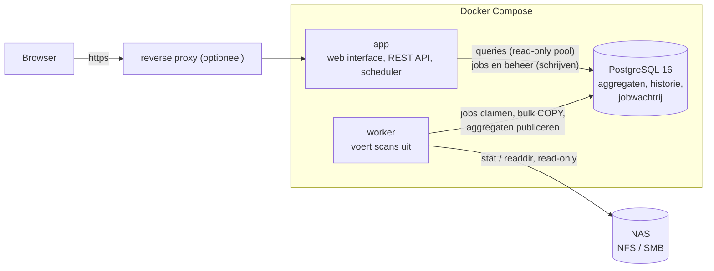

# NAS Storage Analyzer

Self-hosted tool die NFS/SMB-shares **read-only** scant en laat zien hoeveel ruimte data inneemt: per share,
per map en per bestandstype. Gebouwd voor shares met miljoenen bestanden en tientallen terabytes: de scanner leest
alleen metadata, schrijft grote batches naar PostgreSQL en houdt voorberekende totalen bij, zodat elke weergave
snel blijft.

* **Scanner**: parallelle workers, alleen metadata (`stat` en directory-listings, nooit bestandsinhoud),
  incrementeel (onveranderde mappen worden hergebruikt), uitsluitpatronen, symlinks niet gevolgd, hardlinks één keer
  geteld, werkelijke grootte (`st_blocks*512`) naast logische grootte, IO-begrenzing, annuleren, live voortgang.
* **Weergave**: dashboard met donut en groeigrafiek, mappenbrowser met percentages en sorteren, treemap, combineerbare
  filters (categorie, extensie, grootte, gewijzigd, laatst gebruikt, naam), grootste en koudste bestanden en mappen,
  zoeken, CSV-export.
* **Verwijderscripts** (alleen beheerders): vink bestanden aan in de bestandslijsten en krijg één script (`.ps1`, `.cmd` of `.sh`)
  dat precies die bestanden verwijdert, op je pc via SMB of op de NAS zelf. **De applicatie verwijdert zelf niets**: zij schrijft de
  tekst, jij draait het script. Het script toont eerst een samenvatting, vraagt `DELETE <aantal>` te typen en laat een bestand staan
  dat sinds de scan is veranderd. Hoogstens 2.000 bestanden per script; de padbasis (hoe jouw machine de share ziet) stel je per share
  in. Wat het script niet veilig kan aanspreken laat het weg en noemt het (zie [ADR 0006](docs/adr/0006-delete-scripts.md)).
* **Bestandstypes** in acht categorieën (Video, Audio, Afbeeldingen, Documenten, Archieven, Code, Disk images, Overig)
  met een aanpasbare extensietabel; een wijziging werkt direct door in alle cijfers, zonder opnieuw te scannen.
* **Historie**: per scan een momentopname, met instelbare bewaartermijn; groei per categorie in de tijd.
* **Beveiliging**: lokale accounts met Argon2id, **verplichte tweede factor** (authenticator-app of passkey, ook
  wachtwoordloos met alleen een passkey), herstelcodes, lockout, CSRF-bescherming, rollen Admin en Viewer, auditlog,
  setup-wizard zonder standaardwachtwoorden.
* **Beheer**: scheduler met cron per share (persistente jobstatus), OpenAPI-REST-API, Prometheus-`/metrics`, JSON-logs,
  health checks. Interface in Nederlands en Engels, binaire of decimale eenheden, licht, donker of volgens het systeem, en een accentkleur die elke gebruiker zelf kiest (Instellingen → Weergave en taal).

## Snel starten

Vereist: Docker met Compose v2.

```bash
git clone https://github.com/helmerzNL/NAS-Storage-Analyzer.git
cd NAS-Storage-Analyzer
./scripts/init-env.sh              # maakt .env: de mappen (zie onder) en willekeurige geheimen (database-wachtwoord, encryptiesleutel, setup-token)
docker compose up -d
```

De stack haalt de image op van `ghcr.io/helmerznl/nas-storage-analyzer`; er wordt op de server niets gebouwd. `NASA_TAG` in `.env`
kiest welke: `latest` (stabiel, standaard), `beta` (de build waar elke wijziging eerst in landt; de interface toont dan een
**beta**-label, gebruik een aparte `DATA_PATH`) of een versienummer om vast te zetten. Zolang er nog geen promotie naar `main` is geweest
bestaat `latest` nog niet: zet dan `NASA_TAG=beta`, of bouw de image uit deze map met
`docker compose -f docker-compose.yml -f docker-compose.build.yml up -d --build`.

**Waar de data staat.** Alles wat niet verloren mag gaan (de database: `DATA_PATH/postgres`) staat in één **absolute** map op de
host, `DATA_PATH` in `.env`. Het zijn gewone mappen, geen Docker-volumes, dus `docker compose down -v`, een prune of een
herbouw raakt ze niet. Een relatief pad (`./data`) is niet toegestaan: dat wordt opgelost door de tool die de stack start (Dockhand op
Unraid loste zo'n pad bij een andere Flux76-app op naar het RAM-schijfgeheugen; baseline §21). Op Unraid bijvoorbeeld `/mnt/cache/appdata/nas-storage-analyzer`, elders
`/srv/nas-storage-analyzer`. `init-env.sh` weigert een relatief pad (`--data-path`, `--shares-dir`).
**Heb je een installatie van vóór deze instelling** (database in het volume `db-data`)? Dan verplaats je die eenmalig, vóór je de
nieuwe versie uitrolt: [`docs/deploy.md` §8](docs/deploy.md#8-bijwerken).

Open <http://127.0.0.1:8080>, voer de setup-token uit `.env` in, maak het beheerdersaccount aan en stel de tweede
factor in. Voeg daarna een share toe (**Shares → Share toevoegen**) en klik op **Scan nu** op het dashboard.

Zet in `.env` `NASA_SHARES_DIR` (verplicht, een absoluut pad) op de map op de Docker-host waar je NAS-shares gemount zijn; die verschijnt
read-only als `/mnt/shares` in de containers (of op een pad naar keuze, zie `NASA_SHARES_MOUNT`). Draait de stack op
de NAS zelf, bijvoorbeeld Unraid, dan hoef je niets te mounten. Zie [Shares beschikbaar maken](#shares-beschikbaar-maken).

## Architectuur



* **`app`** serveert de interface (in de binary ingebakken), de REST API en de scheduler. Hij scant niet en draait
  zonder rechten. Alleen voor de mapkiezer in het share-formulier leest hij (read-only, alleen voor beheerders) de
  namen van mappen onder de share-map; bestanden worden niet getoond of geopend.
* **`worker`** haalt scanjobs uit de wachtrij in de database (`FOR UPDATE SKIP LOCKED`), scant, en publiceert het
  resultaat in één transactie; een geannuleerde of mislukte scan laat de eerdere gegevens ongemoeid. Alleen de
  worker scant de NAS, en alleen in de aanbevolen opzet via een read-only bind-mount.
* **PostgreSQL** bewaart de bestandsindex (per share een eigen partitie, mappen als `ltree`) en de voorberekende
  totalen per map, per map en categorie, en per extensie. Daardoor lezen de meeste weergaven een paar duizend
  rijen in plaats van alle bestanden. Metingen op 10 miljoen bestanden: [`docs/bench-phase2.md`](docs/bench-phase2.md).

Het volledige ontwerp en de afwegingen staan in [`docs/ontwerp.md`](docs/ontwerp.md).

## Shares beschikbaar maken

Aanbevolen (**route b**): mount de NFS- of SMB-share op de Docker-host, read-only, en geef die map door:

```bash
# /etc/fstab op de host
nas.lan:/volume1/media  /srv/nas/media  nfs  ro,vers=4.1,_netdev,x-systemd.automount,noatime  0 0
```
```bash
# .env
NASA_SHARES_DIR=/srv/nas
```

Voeg de share in de interface toe als type *Gemount pad*: klik op **Bladeren…** en kies de map, of typ het pad
(`/mnt/shares/media`). De containers kunnen dan niets op de NAS wijzigen en hebben geen speciale rechten nodig.

Gebruik voor `NASA_SHARES_DIR` een **absoluut pad** op de host (op Unraid bijvoorbeeld `/mnt/user`): de standaard
`./shares` is een lege map in de stackmap. Zie
[Unraid, Portainer, Dockge](docs/deploy.md#unraid-portainer-dockge-en-andere-stack-managers).

Draait de stack **op de NAS zelf** (route c)? Dan is er niets te mounten: de shares zijn gewone mappen. Geef die map
door en zet `NASA_SHARES_MOUNT` op hetzelfde pad. In de interface typ je dan het pad dat je van de NAS kent. Voorbeeld
voor Unraid:

```bash
# .env
NASA_SHARES_DIR=/mnt/user
NASA_SHARES_MOUNT=/mnt/user
```

Voeg elke share apart toe (**Bladeren…**, of typ bijvoorbeeld `/mnt/user/media`). Alleen wat je toevoegt wordt gescand.
Meldt de kiezer of de scan *permission denied* voor een map met `drwxrwx---` voor `nobody:users`? Zet dan
`NASA_SHARES_GID=100`, zie [Leesrechten](docs/deploy.md#unraid-portainer-dockge-en-andere-stack-managers). Losse Unraid-schijven
in plaats van de (tragere) FUSE-laag `/mnt/user`, Exclusive shares en andere NAS-systemen:
[`docs/deploy.md`](docs/deploy.md#route-c-de-stack-draait-op-de-nas-zelf).

Alternatief (**route a**): de worker mount zelf, met `docker compose -f docker-compose.yml -f docker-compose.mounts.yml up -d`.
Dat geeft alleen de worker root en `CAP_SYS_ADMIN`. Je vult dan in de interface server, export of share, versie en
eventueel SMB-inloggegevens in (versleuteld opgeslagen). Details, SMB-voorbeelden, AppArmor en late mounts:
[`docs/deploy.md`](docs/deploy.md#2-shares-beschikbaar-maken).

> Route a is in de ontwikkelomgeving getest tot en met de rechten en met een nagebootste mount-uitvoerder, maar niet
> tegen een echte NFS- of SMB-server. Test een nieuwe share met *Scan nu* en lees zo nodig de melding op het dashboard.

Een share die niet (meer) gemount is, laat een lege map achter. Een scan die dan niets vindt terwijl de vorige
meer dan 100 bestanden zag, wordt geweigerd en laat de oude gegevens staan.

## Configuratie

Alle instellingen staan met uitleg in [`.env.example`](.env.example). De belangrijkste:

| Variabele | Betekenis |
|---|---|
| `DATA_PATH` | Vereist. Absolute map op de host met alles wat bewaard moet blijven; de database staat in `DATA_PATH/postgres`. Nooit relatief, nooit een Docker-volume. |
| `NASA_TAG` | Welke image: `latest` (standaard), `beta` of een versienummer. Wordt ook in de container gezet; een beta-build toont een **beta**-label. |
| `NASA_DB_PASSWORD`, `NASA_ENCRYPTION_KEY` | Vereist. Gemaakt door `scripts/init-env.sh`. De sleutel versleutelt SMB-wachtwoorden; bewaar hem bij je back-up. |
| `NASA_SETUP_TOKEN` | Nodig om de eerste beheerder aan te maken (anders staat een willekeurige token in het log van `app`). |
| `NASA_SHARES_DIR` | Vereist. Absolute map op de host met de gemounte shares (read-only, standaard als `/mnt/shares` in de containers). |
| `NASA_SHARES_GID` | Groep waar de containers lid van worden om je shares te kunnen lezen. Nodig als een share alleen voor de eigenaar en één groep leesbaar is (Unraid: `drwxrwx---` voor `nobody:users`): zet `100`. Standaard de eigen groep van de image, dus niets verandert. |
| `NASA_SHARES_MOUNT` | Waar die map in de containers komt, en dus het pad dat je in de interface typt. Standaard `/mnt/shares`; zet het gelijk aan `NASA_SHARES_DIR` en de paden zijn overal hetzelfde. |
| `NASA_HTTP_BIND`, `NASA_HTTP_PORT` | Waar `app` luistert; standaard alleen `127.0.0.1:8080`. |
| `NASA_TRUSTED_PROXIES`, `NASA_REQUIRE_HTTPS` | Achter een reverse proxy: welke proxy's `X-Forwarded-*` mogen zetten, en https afdwingen. |
| `NASA_RP_ID`, `NASA_RP_ORIGINS` | Passkeys zijn aan een hostnaam gebonden; zet deze in productie. |
| `NASA_METRICS_TOKEN` | Bearer-token voor `/metrics`; zonder token alleen vanaf loopback. |
| `NASA_UPDATE_CHECK` | Standaard `true`: de app vraagt github.com of er een nieuwere release is en meldt dat aan de beheerder (banner, en Instellingen → Systeem). Hij werkt niets bij en stuurt niets over jouw installatie mee (vaste `User-Agent`, geen versie, geen id). `false` zet hem uit. |
| `NASA_TZ` | Tijdzone voor cron-schema's en het dag/nacht-venster. |
| `PG_*` | PostgreSQL afstellen op het beschikbare geheugen. |

Wil je het wachtwoord en de sleutel niet als omgevingsvariabele, gebruik dan Docker secrets:
`./scripts/init-env.sh --secrets` en `docker compose -f docker-compose.yml -f docker-compose.secrets.yml up -d`.
De meeste `NASA_*`-instellingen, waaronder het database-wachtwoord en de encryptiesleutel, accepteren ook een `_FILE`-variant (bijvoorbeeld `NASA_DB_PASSWORD_FILE`).

## Reverse proxy

Zet de app achter https zodra hij buiten je eigen host bereikbaar is (cookies worden dan `Secure`, en passkeys
werken alleen via https of `localhost`). Voorbeeld met Caddy:

```caddyfile
nas.example.com {
    reverse_proxy 127.0.0.1:8080 {
        flush_interval -1      # live scanvoortgang (server-sent events)
    }
}
```

```bash
# .env
NASA_TRUSTED_PROXIES=127.0.0.1
NASA_REQUIRE_HTTPS=true
NASA_RP_ID=nas.example.com
NASA_RP_ORIGINS=https://nas.example.com
```

Voorbeelden voor nginx en Traefik en uitleg over `X-Forwarded-*`: [`docs/deploy.md`](docs/deploy.md#3-reverse-proxy-en-https).

## Back-up en herstel

Alles staat in PostgreSQL, plus de encryptiesleutel buiten de database.

```bash
docker compose exec -T db sh -c 'pg_dump -U "$POSTGRES_USER" -d "$POSTGRES_DB" -Fc' > nasa-$(date +%F).dump
```

Herstellen: `docker compose up -d db`, dan
`docker compose exec -T db sh -c 'pg_restore -U "$POSTGRES_USER" -d "$POSTGRES_DB" --clean --if-exists --no-owner' < nasa-….dump`,
dan `docker compose up -d`. Het volledige stappenplan en wat je wel en niet hoeft te bewaren:
[`docs/deploy.md`](docs/deploy.md#5-back-up-en-herstel).

## Bekende beperkingen

* **atime is vaak onbetrouwbaar.** Veel NAS-systemen en netwerkmounts werken de leestijd niet bij. De scanner meet
  per scan hoe betrouwbaar atime lijkt en de interface waarschuwt bij "niet gebruikt sinds"; per share kies je
  atime, wijzigingsdatum of het maximum van beide. "Laatst gebruikt" blijft een schatting.
* **Incrementele scans** hergebruiken een map als `mtime` en aantal entries gelijk zijn. Een bestand dat in place
  groeit en een nieuwe hardlink in een ongewijzigde map worden pas bij de volgende volledige scan gezien
  (standaard elke zevende; ook met één klik).
* Twee brede leeftijdsfilters over een héle share van 10 miljoen bestanden duren 2,0–2,6 s; alle andere weergaven
  blijven onder 500 ms.
* Eén directory wordt in één keer gelezen; een map met miljoenen entries kost merkbaar geheugen in de worker.
* **Verwijderscripts** zijn alleen zo goed als de index: ze controleren grootte en tijd vóór het verwijderen, maar een bestand dat
  sinds de scan is vervangen door een ander van gelijke grootte en tijd is niet te onderscheiden. Windows kan sommige Linux-namen
  niet aanspreken (die laat het script weg), `cmd` laat lege bestanden weg en vergelijkt alleen de grootte, en bestanden die alleen in
  hoofdletters verschillen worden weggelaten. Zie [ADR 0006](docs/adr/0006-delete-scripts.md).
* Geen OIDC; de auth-laag is zo opgezet dat een extra inlogmethode een sessie kan aanmaken, maar de koppeling is niet gebouwd.

Alle beperkingen met toelichting: [`docs/deploy.md`](docs/deploy.md#9-bekende-beperkingen).

## Ontwikkelen en testen

**Werkafspraken** (voor mensen en AI-agents): [`AGENTS.md`](AGENTS.md). Pull requests gaan naar `beta`; `main` krijgt alleen een
promotie-PR vanuit `beta`. Pull requests wijzigen `VERSION` niet, dat doet de pipeline. Activeer na het clonen de hooks met
`python scripts/setup_hooks.py`. Wat een operator nodig heeft (starten, health checks, limieten voor een proxy, back-up):
[`docs/operations.md`](docs/operations.md).

```bash
cd web && npm ci && npm run build && cd ..     # de interface wordt in de Go-binary ingebakken
go build -o nasa ./cmd/nasa                    # subcommando's: serve, worker, scan, migrate, recategorize, genkey, healthcheck, version
```

```bash
go vet ./... && go test ./...                  # unit tests; databasetests worden overgeslagen zonder database
NASA_TEST_DSN='postgres://user@host/postgres' NASA_REQUIRE_DB=1 go test -race ./...   # met PostgreSQL 16: elke test krijgt een eigen database
cd web && npm run check && npx vitest run      # typecontrole en unit tests van de interface
```

De **browsertest** (`web/e2e`) start een database, `serve` en `worker` en doorloopt met een echte Chromium de hele
applicatie: setup-wizard, authenticator-app, herstelcodes, passkeys (virtuele authenticator), share toevoegen, scannen
door de worker, bladeren, filters, treemap, lijsten, zoeken, CSV, gebruikers en auditlog:

```bash
npm install -g playwright && playwright install chromium     # eenmalig; de test gebruikt de globale installatie
sh web/e2e/run.sh ./nasa postgres://user@127.0.0.1:5432      # vanuit de hoofdmap; `psql` moet beschikbaar zijn
```

Tegen een draaiende Docker-stack (`BASE_URL`, `SETUP_TOKEN`, `SHARE_DIR` en `SHARE_APP_PATH`) staat de aanroep bovenin `web/e2e/e2e.cjs`.

De prestatiemeting op 10 miljoen bestanden:

```bash
go build -o nasabench ./cmd/nasabench
NASA_DB_DSN=postgres://user@host/bench ./nasabench seed -files 10000000 -dirs 200000
NASA_DB_DSN=postgres://user@host/bench ./nasabench queries -runs 20 -out rapport.md
```

Scannen zonder interface kan ook: `nasa scan -path /mnt/shares/media -name media -exclude .snapshot` (zie `nasa scan -h`;
`-dry-run` doet een scan zonder database).

De REST API is beschreven in [`api/openapi.yaml`](api/openapi.yaml) en wordt door `app` op `/openapi.yaml` geserveerd;
contracttests valideren elk antwoord tegen de specificatie.

---

## English summary

NAS Storage Analyzer scans NFS/SMB shares **read-only** (metadata only, never file contents) and shows how much space
data uses per share, folder and file type. It is built for shares with millions of files: a parallel, incremental
scanner, bulk writes to PostgreSQL and precomputed aggregates keep every view fast (under 500 ms at 10 million
files, except two broad age filters at 2.0-2.6 s; see [`docs/bench-phase2.md`](docs/bench-phase2.md)).

**Quick start** (Docker with Compose v2):

```bash
./scripts/init-env.sh              # creates .env: the folders (see below) and random secrets
docker compose up -d
```

The stack pulls `ghcr.io/helmerznl/nas-storage-analyzer`; nothing is built on the server. `NASA_TAG` in `.env` picks the image:
`latest` (stable, the default), `beta` (the build every change lands in first; the interface shows a **beta** label, use a separate
`DATA_PATH`) or a version number to pin. Until the first promotion to `main` there is no `latest` image: use `NASA_TAG=beta`, or
build it from this folder with `docker compose -f docker-compose.yml -f docker-compose.build.yml up -d --build`.

**Where the data lives.** Everything that must not be lost (the database, `DATA_PATH/postgres`) is in one **absolute** host folder,
`DATA_PATH` in `.env`. They are plain folders, never Docker volumes, so `docker compose down -v`, a prune or a rebuild cannot touch
them. A relative path is refused: it is resolved by whatever tool starts the stack (Dockhand on Unraid resolved such a path into the RAM disk in another Flux76 app; baseline §21). If
your database is still in the Docker volume `db-data` (a version from before this setting), move it once, **before** you deploy the
new version: [`docs/deploy.md` §8](docs/deploy.md#8-bijwerken).

Open <http://127.0.0.1:8080>, enter the setup token from `.env`, create the administrator and enrol a second factor
(authenticator app or passkey; mandatory). There are no default passwords. Then add a share and click *Scan nu*.

**Mounting the NAS.** In the share form, *Browse…* lets you click through the folders below the shares folder instead of
typing a path. Recommended: mount the share read-only on the Docker host and point `NASA_SHARES_DIR` at the
parent folder; it appears read-only as `/mnt/shares` in the containers, which need no special privileges. Set
`NASA_SHARES_MOUNT` to change that path; if it equals `NASA_SHARES_DIR`, the paths you type in the interface are the
host paths. When the stack runs on the NAS itself (for example Unraid) there is nothing to mount: set both variables to
the folder that holds the shares (`/mnt/user`) and add each share by its path. Alternative:
`docker compose -f docker-compose.yml -f docker-compose.mounts.yml up -d` lets the worker mount NFS/SMB itself, with
root and `CAP_SYS_ADMIN` in the worker container only (verified up to the privileges; not tested against a real
NFS/SMB server in the development sandbox). A scan that finds an empty share where the previous scan found over 100
files is refused, so a dropped mount does not erase your history.

**Users.** Nobody chooses anyone else's password: an administrator makes an **invitation link** (Instellingen → Gebruikers) that the guest opens to choose their own password or a
passkey. The link is shown once, works once, expires after 7 days and is never stored (only its hash); *Nieuwe inlog-link* brings back a user who cannot sign in. `NASA_PUBLIC_URL` is the address the links point at.
Details: [`docs/deploy.md` §4b](docs/deploy.md#4b-gebruikers-uitnodigen).

**Backup and restore.** *Settings → Backup* (administrators) downloads what you entered (shares, file types, everyone's display preferences) as one small JSON file and puts it back.
It never holds a password, passkey, authenticator secret, recovery code, account or role; an SMB password is in it only encrypted with `NASA_ENCRYPTION_KEY`, which stays outside the file.
Scan results are not in it (scan again after a restore), and it does not replace a database dump. A restore is checked first and changes nothing until you confirm; then the server does it
in one transaction, also if you leave the page. Details: [`docs/deploy.md` §5](docs/deploy.md#5-back-up-en-herstel).

**Delete scripts.** An administrator can tick files in the file lists (Folders → Files, Lists) and get one script (`.ps1`, `.cmd` or `.sh`)
that deletes exactly those files, to run on a PC that sees the share over SMB or on the NAS itself. **The application deletes nothing**: it
writes the text and you run it. The script prints a summary, needs `DELETE <count>` to be typed, and keeps any file whose size or time differs
from the scan. At most 2,000 files per script. Where your machines see the share (`\\nas\media`, `Z:\`, `/mnt/user/media`) is set per share (*Delete scripts* in
the share form) and can be changed when the script is made. Files that cannot be addressed safely (odd characters, names Windows cannot open, names
that differ only in case) are left out and listed in the script. See [ADR 0006](docs/adr/0006-delete-scripts.md).

**Factory reset.** *Settings → System → Factory reset* (administrators) puts the installation back to new: every table of the database is emptied (accounts, shares with their scan data, edited file types, the audit log) and the
setup wizard starts again. A session is not enough: you type `RESET` and prove who you are again, with a passkey or with your password and a code. It is refused while a scan runs, needs no restart, and leaves the environment
(including `NASA_ENCRYPTION_KEY`) and the files on your NAS alone. Make a backup first if you are unsure. Details: [`docs/deploy.md` §5](docs/deploy.md#5-back-up-en-herstel).

**Update check.** The administrator is told when a newer release exists (a banner, dismissible per version, and Settings → System with *Check now*).
It asks `github.com` for the latest published, non-prerelease release of this project, sends only a fixed `User-Agent` (no version, no instance id,
no user data) and never updates anything; switch it off with `NASA_UPDATE_CHECK=false`. A beta build is only told about stable releases.

**Behind a reverse proxy** set `NASA_TRUSTED_PROXIES`, `NASA_REQUIRE_HTTPS=true`, `NASA_RP_ID` and `NASA_RP_ORIGINS`,
and disable response buffering for `/api/v1/events`. **Backup** with `pg_dump -Fc` and keep `NASA_ENCRYPTION_KEY`
with it. **Limits:** atime is often unreliable (the UI warns and can fall back to modification time); incremental
scans miss in-place edits and new hardlinks in unchanged folders until the next full scan; OIDC is not implemented.

Everything in more detail, in Dutch with an English summary at the end: [`docs/deploy.md`](docs/deploy.md). Design:
[`docs/ontwerp.md`](docs/ontwerp.md). API: [`api/openapi.yaml`](api/openapi.yaml).
